<p align="center">
  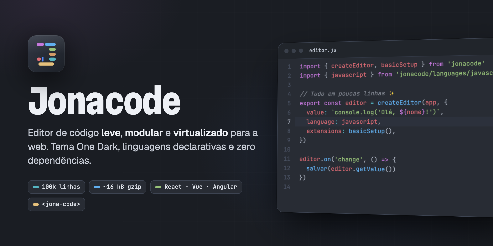
</p>

<p align="center">
  <a href="#instalação"></a>
  <a href="#tamanho"></a>
  
  <a href="LICENSE"></a>
</p>

**Jonacode** (Jona + code) é um editor de código para a web: pequeno, modular e rápido. Ele traz destaque de sintaxe com **11 linguagens prontas** (e as ~80 do Monaco via importador), **lista virtualizada** para arquivos enormes, tema **One Dark** por padrão e uma API declarativa para criar linguagens, inclusive inventadas. Funciona em HTML puro (sem bundler), React, Vue, Angular, Svelte ou em qualquer lugar onde exista um `<div>`.

<table>
  <tr>
    <td width="50%">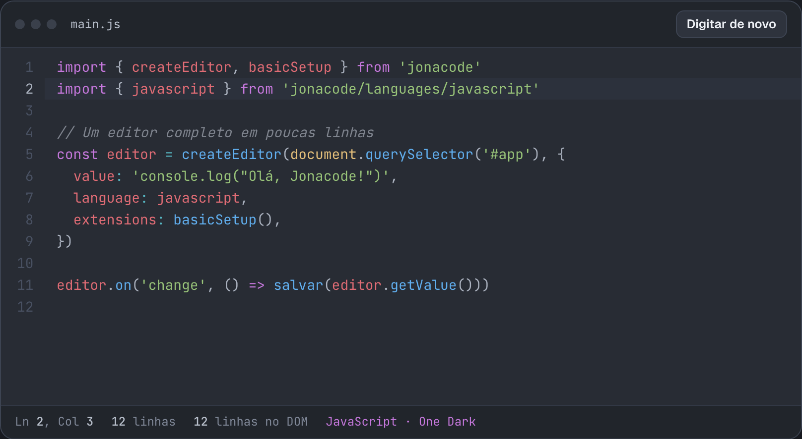</td>
    <td width="50%">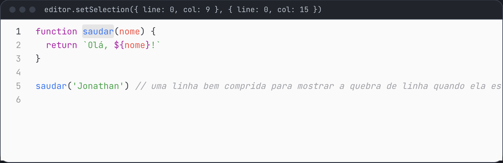</td>
  </tr>
  <tr>
    <td align="center"><sub>One Dark (padrão)</sub></td>
    <td align="center"><sub>One Light</sub></td>
  </tr>
</table>

> [!TIP]
> Abra **[`docs/index.html`](docs/index.html)** direto no navegador: é a documentação interativa, com demos ao vivo de cada mecanismo interno (tokenizador passo a passo, lista virtualizada, tokenização incremental, criador de temas, 2 milhões de linhas, um visualizador de logs). O **[laboratório de linguagens](docs/lab.html)** é uma ferramenta à parte para criar, testar e exportar gramáticas. Ambos são arquivos únicos, sem servidor e sem build.

---

## Sumário

- [Destaques](#destaques) · [Comparativo](#comparativo)
- [Instalação](#instalação)
- [Uso rápido](#uso-rápido)
- [Frameworks](#frameworks) · [React](#react) · [Vue](#vue) · [Web Component e Angular](#web-component-e-angular)
- [Opções](#opções) e [API](#api)
- [Destaque estático e editor sob demanda](#destaque-estático-e-editor-sob-demanda) · [Em formulários](#em-formulários)
- [Múltiplos cursores](#múltiplos-cursores) · [Quebra de linha](#quebra-de-linha) · [Altura automática](#altura-automática) · [Fontes e tamanhos](#fontes-e-tamanhos) · [Busca e substituição](#busca-e-substituição) · [Mobile](#mobile) · [Acessibilidade](#acessibilidade)
- [Arquivos gigantes e logs](#arquivos-gigantes-e-logs)
- [Marcações, tooltips, diagnósticos, autocomplete e folding](#marcações-tooltips-diagnósticos-autocomplete-e-folding) · [Zonas e widgets](#zonas-e-widgets)
- [Validação com tree-sitter](#validação-com-tree-sitter) · [Edição colaborativa](#edição-colaborativa)
- [IA](#ia) · [Ferramentas para agentes](#ferramentas-para-agentes) · [Edições no formato da IA](#edições-no-formato-da-ia) · [Revisão com diff](#revisão-com-diff) · [Sugestões e Ctrl/⌘+K](#sugestões-e-ctrlk) · [Agentes de navegador](#agentes-de-navegador) · [Proteções](#proteções-e-verificação)
- [Temas](#temas) · [Temas do VS Code](#temas-do-vs-code)
- [Linguagens](#linguagens) · [Linguagens prontas](#linguagens-prontas) · [Uma dentro da outra](#uma-linguagem-dentro-da-outra) · [Gramáticas do Monaco](#gramáticas-do-monaco) · [Testando gramáticas](#testando-gramáticas) · [Tokens personalizados](#tokens-personalizados)
- [Extensões](#extensões)
- [Como funciona por dentro](#como-funciona-por-dentro)
- [Tamanho](#tamanho)
- [Atalhos](#atalhos)
- [Desenvolvimento](#desenvolvimento)
- [Limitações e próximos passos](#limitações-e-próximos-passos)

## Destaques

| | |
|---|---|
| 🤖 **Pronto para IA** | Ferramentas prontas para modelos (formato do Claude, OpenAI e MCP/WebMCP), edições no formato que a IA escreve, revisão com diff, texto fantasma e <kbd>Ctrl</kbd>/<kbd>⌘</kbd>+<kbd>K</kbd>. Sem provedor preso: você chama o modelo que quiser. |
| 🌳 **Tree-sitter opcional** | `treeSitter()` valida a sintaxe com o parser do GitHub e do Neovim (WebAssembly) e oferece correções, inclusive no código dentro de HTML e Markdown. Você entrega o `web-tree-sitter`: o Jonacode continua sem dependências. |
| 👥 **Colaborativo** | `collab(yjs(...))`: cursores com nome e cor, avatares, seguir alguém, destaque do que os outros digitam e desfazer só o seu, com qualquer provedor do Yjs ou um backend seu. |
| 🪟 **Zonas entre linhas** | `addZone()` põe elementos seus entre as linhas, com espaço próprio (barra de ações, comentário, prévia), como as *view zones* do Monaco; `addWidget()` flutua junto a uma posição e `addOverlay()` fica num canto. |
| 🔠 **Qualquer fonte** | Monoespaçada ou proporcional, qualquer tamanho e altura de linha. Troca feita só pelo CSS, web font que carrega depois e zoom são medidos de novo; cursor e cliques conferidos contra os glifos nos três motores. |
| 🔀 **Diff e revisão** | `diffView()` com Aceitar/Rejeitar por trecho e `mergeView()` lado a lado, sobre blocos entre linhas que a virtualização entende. |
| ⚡ **Virtualizado** | Só as linhas visíveis existem no DOM: 100.000 linhas carregam em ~15 ms com ~30 elementos na tela. |
| 🧩 **Modular de verdade** | Um módulo ESM por recurso e `"sideEffects": false`. O bundler descarta o que você não importa. |
| 🎨 **Temas por CSS** | Um objeto vira variáveis CSS e classes. `extends` herda um tema e troca só o que você quiser. |
| 🔤 **Linguagens declarativas** | Estados + regex, no estilo Monarch. Uma linguagem nova cabe em 30 linhas. |
| 🗂️ **11 linguagens prontas** | JavaScript, JSX, TypeScript, TSX, JSON, CSS, HTML (com JS e CSS dentro), Markdown, SQL, shell e logs, uma por import. |
| 🧬 **Monaco e VS Code** | `fromMonarch()` usa as ~80 gramáticas do Monaco (100% dos tokens iguais ao lexer dele) e `fromVSCodeTheme()` os temas do VS Code. |
| 🧪 **Gramáticas testáveis** | `expectTokens()` com um formato de `^^^` sob cada token, e um [laboratório](docs/lab.html) para criar, testar e exportar. |
| 🔁 **Tokenização incremental** | Estado por linha, internado e comparado com `===`. Editar re-tokeniza só até convergir. |
| 🧱 **Extensível** | Extensões são funções: atalhos, gutters, camadas e input handlers. |
| 🌐 **Qualquer framework** | Adaptadores para React e Vue, o Web Component `<jona-code>` e um bundle `<script>` clássico. |
| 🖱️ **Múltiplos cursores** | Alt+clique, seleção em coluna, <kbd>Mod</kbd>+<kbd>D</kbd>, e todos os comandos agem em todos os cursores. |
| ↩️ **Quebra de linha** | `lineWrapping: true`: quebras calculadas em JS e um mapa de alturas, então a virtualização continua exata. |
| 🪶 **Estático até ser usado** | `highlight()` gera HTML no servidor, sem o editor (~6,6 kB com JS e tema); `lazyEditor()` troca por um editor no primeiro clique, sem nada se mexer. |
| 📜 **Arquivos gigantes** | Mais de 1 milhão de linhas (modo compacto), `append()` estilo `tail -f`, ir para a linha, contagem de busca em segundo plano. |
| 📝 **Campo de formulário** | `<jona-code name required>` vai junto no `submit`, volta no `reset`, valida e respeita `<fieldset disabled>` e `<label>`. |
| 📏 **Cresce com a página** | Sem altura fixa, o editor acompanha o conteúdo e continua desenhando só as linhas na tela. `minLines`/`maxLines` limitam. |
| 🔍 **Busca e substituição** | Regex, maiúsculas/minúsculas, palavra inteira, `$1` na substituição e "selecionar todas" como cursores. |
| 📱 **Mobile** | Toque, toque duplo/longo, alças de seleção, barra copiar/colar e teclado virtual. Validado no Chrome do Android com Gboard. |
| ♿ **Leitor de tela** | O textarea espelha 10 linhas em volta do cursor, com a seleção; <kbd>Esc</kbd> + <kbd>Tab</kbd> saem do editor; alto contraste. |
| 🏷️ **Tokens personalizados** | Capture tipos novos por regex (`tokenRule`) e estilize com qualquer CSS (`tokenStyles`). |
| ⌨️ **Editor de verdade** | IME (acentos!), clipboard, desfazer agrupado, auto-indentação, fechamento de pares, comentários, mover e duplicar linhas… |

## Comparativo

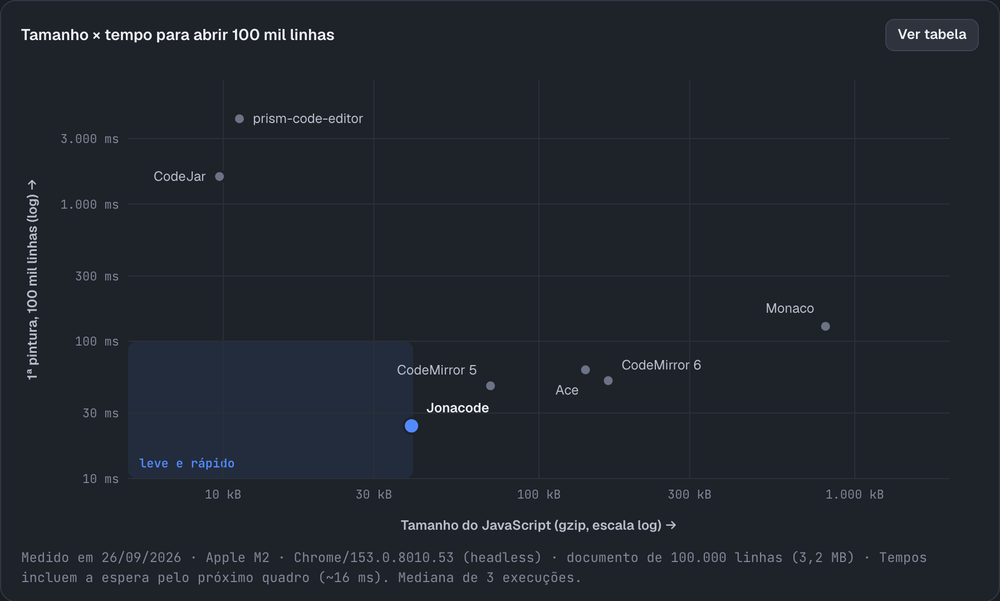

Os editores pequenos travam com arquivos grandes; os que aguentam arquivos grandes são pesados. Medido na mesma máquina, com configurações equivalentes (destaque de JavaScript + "setup básico") e um arquivo de **100 mil linhas**:

| Editor | Configuração | JS gzip | 1ª pintura | Nós no DOM |
|---|---|---:|---:|---:|
| **Jonacode** | basicSetup + JavaScript | **39,5 kB** | **24 ms** | **203** |
| CodeMirror 6 | basicSetup + JavaScript + One Dark | 165,7 kB | 52 ms | 290 |
| CodeMirror 5 | JS + números + colchetes + linha ativa + busca | 70,2 kB | 47 ms | 390 |
| Monaco (mínimo) | editor + linguagens Monarch | 807,8 kB | 129 ms | 440 |
| Ace | JS + tema + busca | 140,4 kB | 62 ms | 318 |
| prism-code-editor | JS + colchetes + comandos + busca | 11,3 kB | 4.183 ms | 577.461 |
| CodeJar | CodeJar + Prism | 9,7 kB | 1.588 ms | 422.422 |

<sub>Medido em 26/09/2026 (o tamanho do Jonacode foi atualizado em 28/09, depois das zonas e da medição de fontes; os tempos são os da rodada completa) · Apple M2 · Chrome/153.0.8010.53 headless · mediana de 3 execuções; tempos incluem a espera do próximo quadro (~16 ms) e variam alguns ms entre rodadas. Reproduza com `cd bench/compare && npm install && npm run bench` (`ONLY=jonacode-full,cm6-full` mede só alguns; `RUNS=9` repete mais).</sub>

Onde somos bons, pelo nosso propósito: **4,2× menor que o CodeMirror 6**, a pintura mais rápida com 100 mil linhas, o menor editor que virtualiza e o único com ferramentas prontas para agentes de IA. Onde ainda perdemos: LSP, texto da direita para a esquerda (RTL), testes com leitores de tela reais e no iOS, e maturidade. A [documentação](docs/index.html#comparativo) traz o comparativo completo: mapa interativo, medições por métrica, matriz de recursos, notas com **pesos ajustáveis** por perfil de projeto e quando escolher cada biblioteca.

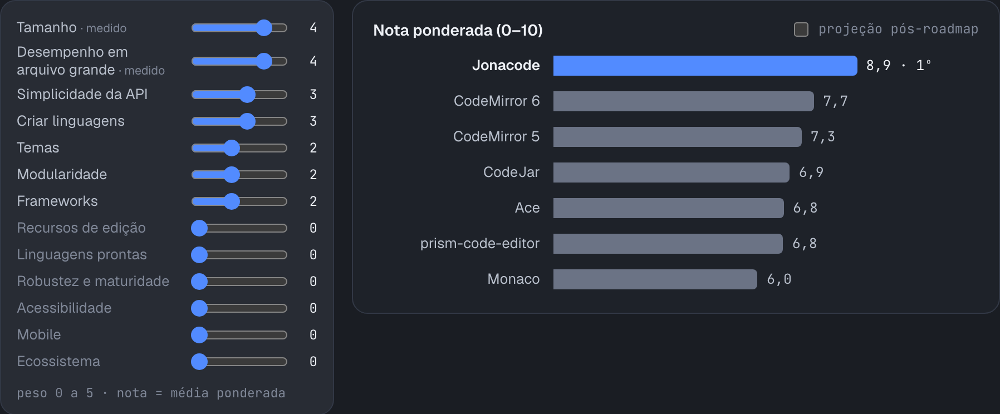

## Instalação

```bash
npm install jonacode
```

<details>
<summary><b>Sem bundler: CDN (ESM)</b></summary>

```html
<div id="app" style="height: 400px"></div>

<script type="module">
  import { createEditor, basicSetup } from 'https://esm.sh/jonacode'
  import { javascript } from 'https://esm.sh/jonacode/languages/javascript'

  createEditor(document.getElementById('app'), {
    value: 'console.log("olá")',
    language: javascript,
    extensions: basicSetup(),
  })
</script>
```
</details>

<details>
<summary><b>Sem bundler: <code>&lt;script&gt;</code> clássico (global <code>Jonacode</code>)</b></summary>

```html
<script src="https://cdn.jsdelivr.net/npm/jonacode/dist/jonacode.iife.min.js"></script>

<div id="app" style="height: 400px"></div>
<script>
  const { createEditor, basicSetup, javascript } = Jonacode
  createEditor(document.getElementById('app'), { language: javascript, extensions: basicSetup() })
</script>
```
</details>

<details>
<summary><b>Sem bundler: import map apontando para <code>node_modules</code></b></summary>

Os arquivos em `dist/` são ESM puro, um por módulo, e rodam direto no navegador:

```html
<script type="importmap">
  { "imports": { "jonacode/": "./node_modules/jonacode/dist/" } }
</script>
<script type="module">
  import { createEditor, basicSetup } from 'jonacode/index.js'
  import { javascript } from 'jonacode/languages/javascript.js'
</script>
```
</details>

## Uso rápido

```js
import { createEditor, basicSetup } from 'jonacode'
import { javascript } from 'jonacode/languages/javascript'

const editor = createEditor(document.querySelector('#app'), {
  value: 'const saudacao = "Olá, mundo!"',
  language: javascript,       // opcional: sem ela, texto puro
  extensions: basicSetup(),   // números de linha, colchetes, atalhos…
})

editor.on('change', () => console.log(editor.getValue()))
```

- Sem `theme`, o editor usa o **One Dark**.
- O editor ocupa a altura do elemento pai. Dê uma altura ao container para rolar e virtualizar, ou deixe sem altura para crescer com o conteúdo.
- `basicSetup()` é só uma lista de extensões, e cada uma pode ser desligada: `basicSetup({ lineNumbers: false, search: false })`. Ela inclui números de linha, linha ativa, pares de colchetes, fechamento automático, atalhos extras, múltiplos cursores, busca e toque.

## Frameworks

### React

```jsx
import { useState } from 'react'
import { CodeEditor } from 'jonacode/react'
import { basicSetup } from 'jonacode'
import { javascript } from 'jonacode/languages/javascript'

const extensions = basicSetup() // fora do componente: não reinstala a cada render

export function App() {
  const [code, setCode] = useState('const a = 1')
  return (
    <CodeEditor
      value={code}
      onChange={setCode}
      language={javascript}
      extensions={extensions}
      style={{ height: 400 }}
      onReady={(editor) => editor.focus()}
    />
  )
}
```

Controlado (`value`) ou não controlado (`defaultValue`). O `ref` aponta para a instância do `Editor`.

### Vue

```vue
<script setup>
import { ref } from 'vue'
import { CodeEditor } from 'jonacode/vue'
import { basicSetup } from 'jonacode'
import { javascript } from 'jonacode/languages/javascript'

const code = ref('const a = 1')
const extensions = basicSetup()
</script>

<template>
  <CodeEditor v-model="code" :language="javascript" :extensions="extensions" style="height: 400px" />
</template>
```

### Web Component e Angular

O `<jona-code>` funciona em qualquer lugar que renderize HTML. Nada é registrado até você chamar `defineJonacodeElement()`, e o conteúdo inicial vem do próprio elemento:

```html
<jona-code language="javascript" style="height: 300px">
  function soma(a, b) {
    return a + b
  }
</jona-code>

<script type="module">
  import { defineJonacodeElement, basicSetup } from 'jonacode/element'
  import { javascript } from 'jonacode/languages/javascript'

  defineJonacodeElement({ languages: [javascript], extensions: basicSetup() })
  document.querySelector('jona-code').addEventListener('change', (e) => console.log(e.detail.value))
</script>
```

No **Angular**, registre o elemento uma vez (por exemplo, no `main.ts`) e adicione `schemas: [CUSTOM_ELEMENTS_SCHEMA]` ao componente:

```html
<jona-code language="javascript" [value]="code" (change)="code = $event.detail.value"></jona-code>
```

Atributos: `language`, `theme`, `readonly`, `placeholder`, `tab-size`, `font-size`, `min-lines`, `max-lines`, `name`, `required` e `lazy`. Propriedades: `value`, `defaultValue`, `editor`, `language`, `theme`, `extensions`, `readOnly`. Svelte, Solid e Lit podem usar o Web Component ou `createEditor` + `destroy()` no ciclo de vida.

### Em formulários

O `<jona-code>` é um elemento *associado a formulário*, como um `<textarea>`:

```html
<form method="post" action="/consultas">
  <label for="sql">Consulta</label>
  <jona-code id="sql" name="consulta" language="sql" required lazy></jona-code>
  <button>Enviar</button>          <!-- FormData: { consulta: "SELECT …" } -->
</form>
```

Com `name`, vai junto no envio; `form.reset()` volta ao conteúdo inicial; `required` participa da validação (`:invalid`, `checkValidity()`, `reportValidity()`, `setCustomValidity()`); um `<fieldset disabled>` o deixa só leitura e fora do envio; e o `<label for>` dá nome a ele e o foca. Em documentos enormes o valor do formulário é atualizado com atraso de 300 ms, para não montar o texto inteiro a cada tecla, e `e.detail.value` do evento `change` só é calculado se você ler.

## Destaque estático e editor sob demanda

Para blocos de código que ninguém vai editar, você não precisa do editor. `highlight()` usa as mesmas gramáticas e temas e devolve uma string de HTML, sem tocar no DOM: roda no servidor (SSR, geradores de site estático) ou no navegador.

```js
import { highlight, highlightStyles, highlightAll } from 'jonacode/highlight'
import { javascript } from 'jonacode/languages/javascript'
import { oneDark } from 'jonacode/themes/one-dark'

const html = highlight(codigo, javascript, { theme: oneDark, lineNumbers: true })
const css = highlightStyles(oneDark)                        // uma vez por página

// ou destaque os <pre><code class="language-js"> da página, como o Prism faz
highlightAll({ languages: [javascript], theme: oneDark })
```

Uma página com muitos trechos editáveis não precisa pagar por todos os editores de uma vez. `lazyEditor()` mostra o destaque estático (o que veio do servidor, ou gerado ali) e só cria o editor no primeiro clique, toque ou foco (`on: 'visible'` quando entra na tela, `on: 'idle'` quando o navegador fica ocioso). O bloco estático tem **a mesma geometria do editor** (margens, altura de linha arredondada, números de linha), então a troca acontece sem nada se mexer, e o cursor cai onde você clicou. No Web Component, é o atributo `lazy`.

```js
import { lazyEditor, basicSetup } from 'jonacode'

const trecho = lazyEditor(el, { value, language: javascript, extensions: basicSetup() })
const editor = await trecho.ready        // quando alguém interagir
```

Só o destacador, com JavaScript e o One Dark, pesa ~6,6 kB gzip.

## Opções

| Opção | Tipo | Padrão | Descrição |
|---|---|---|---|
| `value` | `string` | `''` | Conteúdo inicial. |
| `language` | `Language` | texto puro | Linguagem do destaque de sintaxe. |
| `theme` | `Theme` | `oneDark` | Tema de cores. |
| `extensions` | `Extension` | — | Função, lista ou listas aninhadas de extensões. |
| `tabSize` | `number` | `2` | Largura do tab e da unidade de indentação. |
| `insertSpaces` | `boolean` | `true` | Indentar com espaços (ou com tab). |
| `readOnly` | `boolean` | `false` | Bloqueia edições do usuário (a API continua podendo editar). |
| `lineWrapping` | `boolean` | `false` | Quebra linhas longas na largura do editor. |
| `minLines` · `maxLines` | `number` | — | Altura mínima e máxima em linhas. Sem altura no pai, o editor cresce com o conteúdo (e continua virtualizado); passando de `maxLines`, rola por dentro. |
| `phrases` | `Record<string, string>` | — | Traduções da interface (busca, barra de toque): `{ Find: 'Buscar' }`. |
| `placeholder` | `string` | — | Texto mostrado com o documento vazio. |
| `fontSize` · `fontFamily` · `lineHeight` | `number \| string` | `14` · JetBrains Mono… · `1.6` | Tipografia (vira variável CSS). Qualquer fonte, inclusive proporcional: veja [Fontes e tamanhos](#fontes-e-tamanhos). |
| `autofocus` | `boolean` | `false` | Foca ao criar. |
| `onChange` | `(value, event) => void` | — | Chamado a cada mudança. |
| `className` · `ariaLabel` | `string` | — | Classe extra na raiz e rótulo acessível. |

Tudo pode mudar depois com `editor.setOptions({ ... })`, inclusive `language`, `theme` e `extensions`.

## API

| Membro | Descrição |
|---|---|
| `getValue()` · `setValue(texto)` | Lê ou troca o documento inteiro (`setValue` zera o histórico e preserva o cursor quando possível). |
| `selection` · `setSelection(âncora, cabeça?)` | Range principal `{ anchor, head }` com posições `{ line, col }` começando em zero. |
| `ranges` · `mainIndex` · `setSelections(ranges, main?)` | Todos os cursores (ordenados, sem sobreposição). |
| `changeByRange(fn)` | Edita cada cursor: `fn(range)` devolve `{ changes, range }`. Uma transação, um passo de desfazer. |
| `getSelectedText()` · `replaceSelection(texto)` | Texto selecionado e substituição. |
| `dispatch(transação)` | Aplica mudanças e seleção: `{ changes, selection, origin, scrollIntoView }`. |
| `undo()` · `redo()` · `canUndo` · `canRedo` | Histórico. |
| `setOptions(parcial)` | Atualiza qualquer opção. |
| `doc` | O documento: `lines`, `lineCount`, `line(n)`, `slice(de, até)`. |
| `getTokens(linha)` | Tokens de uma linha. |
| `append(texto, { follow? })` | Acrescenta ao fim fora do histórico, seguindo o fim se ele estava na tela. |
| `scrollBy(dy)` | Rola o conteúdo `dy` px (1:1 mesmo no modo compacto). |
| `languageAt(pos)` | A linguagem no ponto (JavaScript dentro de um `<script>`, por exemplo). |
| `coordsAtPos(pos)` · `posAtCoords(x, y)` · `posAtClient(x, y)` | Geometria. |
| `clientToContent(x, y)` · `contentToClient(x, y)` | Converte entre coordenadas da tela e do texto (com a escala de um `transform` nos ancestrais). |
| `charWidth` · `digitWidth` · `lineHeight` · `monospace` · `gutterWidth` | Medidas da fonte (em px, sem arredondar a largura) e se toda coluna tem a mesma largura. |
| `setLineGaps(nome, lacunas)` · `gapBlock(linha, lado)` | Espaço acima/abaixo de linhas, em linhas ou em px: a base das zonas e dos blocos. |
| `rangeRects(de, até)` · `lineBlock(linha)` | Retângulos de um trecho (um por linha visual) e a faixa vertical de uma linha: base para destaques. |
| `scrollIntoView(pos?, centro?)` · `visibleRange` · `viewportHeight` | Rolagem, faixa de linhas renderizadas e altura visível. |
| `focus()` · `blur()` · `hasFocus` | Foco. |
| `on(evento, fn)` | `change`, `selection`, `render`, `scroll`, `focus`, `blur`, `destroy`. Retorna a função que remove o listener. |
| `destroy()` | Remove DOM, observers e listeners. |

Comandos avulsos (tree-shakable) ficam em `commands`: `commands.toggleComment(editor)`, `commands.moveLineDown(editor)`, `commands.selectAll(editor)`…

## Múltiplos cursores

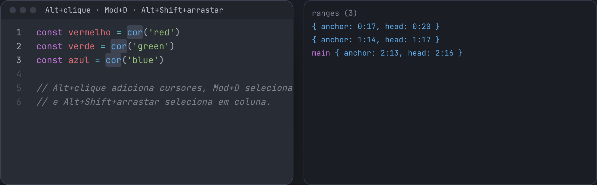

A seleção é uma lista de ranges `{ ranges, main }`, sempre ordenada e sem sobreposição. Com `multiCursor()` (no `basicSetup`):

| Gesto / atalho | Ação |
|---|---|
| <kbd>Alt</kbd>+clique | Adiciona (ou remove) um cursor |
| <kbd>Alt</kbd>+<kbd>Shift</kbd>+arrastar | Seleção em coluna |
| <kbd>Mod</kbd>+<kbd>D</kbd> | Seleciona a palavra, depois a próxima ocorrência |
| <kbd>Mod</kbd>+<kbd>Shift</kbd>+<kbd>L</kbd> | Um cursor em cada ocorrência |
| <kbd>Mod</kbd>+<kbd>Alt</kbd>+<kbd>↑</kbd>/<kbd>↓</kbd> | Adiciona cursor acima / abaixo |
| <kbd>Esc</kbd> | Volta a um cursor |

Colar um texto com uma linha por cursor distribui as linhas entre eles, como no VS Code. Para escrever seus próprios comandos, use `changeByRange`: você escreve para um cursor e o editor aplica em todos.

```js
editor.changeByRange((range) => {
  const [from, to] = editor.wordRange(range.head)
  const word = editor.doc.slice(from, to).toUpperCase()
  return { changes: { from, to, insert: word }, range: { anchor: from, head: to } }
})
```

## Quebra de linha

```js
createEditor(el, { lineWrapping: true })
editor.setOptions({ lineWrapping: false })        // liga e desliga a qualquer momento
```
```html
<jona-code line-wrapping></jona-code>             <!-- atributo no Web Component -->
<CodeEditor lineWrapping />                       <!-- prop no React / Vue -->
```

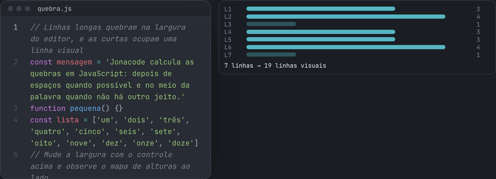

As quebras são calculadas em JavaScript (depois de espaços quando possível, no meio da palavra quando não), e o editor insere um `<br>` em cada uma. Como as posições são conhecidas sem medir o DOM, a lista continua virtualizada: um mapa de alturas guarda as linhas visuais de cada linha, com somas prefixadas, então achar a linha sob um pixel é uma busca binária. As setas ↑/↓ andam por linha visual.

## Altura automática

```js
createEditor(el, { minLines: 3, maxLines: 30 })   // cresce de 3 até 30 linhas, depois rola por dentro
createEditor(el)                                  // pai sem altura: cresce com todo o conteúdo
```
```html
<jona-code min-lines="3" max-lines="30"></jona-code>
```

Sem altura definida no elemento pai, o editor cresce com o conteúdo e a rolagem passa a ser a da página, mas a virtualização continua: o Jonacode desenha só a **interseção do editor com a janela** (e com cada ancestral que rola) e redesenha quando qualquer coisa em volta rola. Um editor de 3.000 linhas dentro de uma página mantém ~20 linhas no DOM. Quando o cursor sai da tela (Page Down, busca, `scrollIntoView`), quem rola é a página.

## Fontes e tamanhos

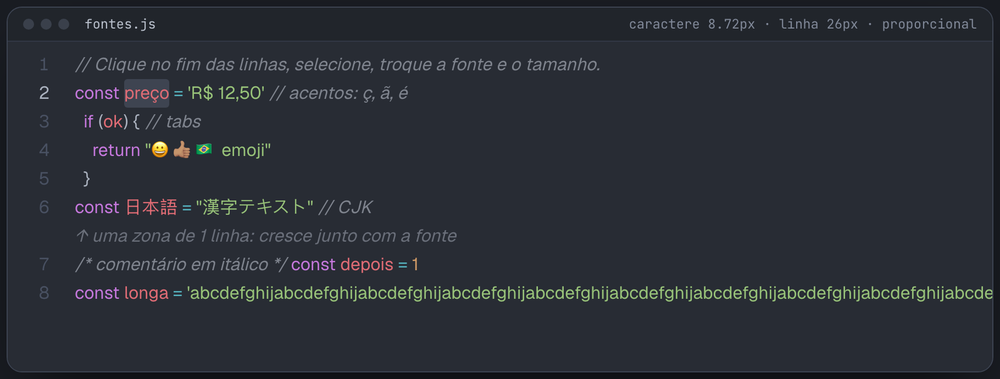

Qualquer fonte e qualquer tamanho funcionam, pela opção ou só pelo CSS:

```js
createEditor(el, { fontFamily: "'Fira Code', monospace", fontSize: 15, lineHeight: 1.5 })
editor.setOptions({ fontSize: 18 })
```

```css
.meu-editor { --jc-font-family: Georgia, serif; --jc-font-size: 1.1rem; --jc-line-height: 1.7 }
```

O editor mede a fonte num elemento escondido junto das linhas, que herda os mesmos estilos, e mede de novo sempre que ele muda de tamanho. Isso cobre uma web font que termina de carregar, um tema ou classe nova, uma media query e o zoom do navegador. A largura do caractere vem com fração de pixel: arredondada, ela desviava 1 px a cada poucas centenas de colunas.

- **Fontes proporcionais** (Geist, Georgia, Inter…) são detectadas. O cursor, a seleção e os cliques passam a usar a posição real das letras, e a quebra de linha usa a largura de cada caractere.
- **Negrito sintético:** sem uma variante negrito, o Safari desenha um negrito mais largo que o normal. O editor mede os dois, e o cursor não escorrega depois de um token em negrito.
- **A altura da linha** fica em pixels inteiros, igual à dos blocos estáticos de `highlight()`. O gutter dos números usa a largura de um dígito, então os números cabem em qualquer fonte.
- **Com `transform: scale()`** nos ancestrais, cliques e cursor continuam certos. `editor.contentToClient()` / `clientToContent()` convertem as coordenadas.

O teste `e2e/fonts.spec.ts` compara, nos três motores, onde o editor põe cada coluna com onde o navegador desenhou a letra. Os casos são:
- fontes monoespaçadas e proporcionais, em dois tamanhos e com duas alturas de linha;
- fonte trocada só pelo CSS e web font que carrega depois;
- quebra de linha com fonte proporcional;
- negrito sintético;
- números de linha com dígitos proporcionais;
- editor escalado.

## Busca e substituição

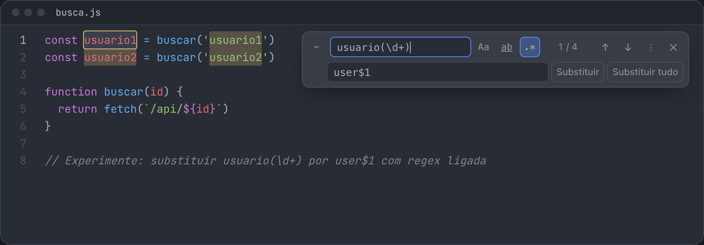

`search()` (no `basicSetup`) abre com <kbd>Mod</kbd>+<kbd>F</kbd>, e a substituição com <kbd>Mod</kbd>+<kbd>Alt</kbd>+<kbd>F</kbd> ou <kbd>Ctrl</kbd>+<kbd>H</kbd>. Tem opções de maiúsculas/minúsculas, palavra inteira e regex; <kbd>Enter</kbd>/<kbd>Shift</kbd>+<kbd>Enter</kbd> navegam, e <kbd>Alt</kbd>+<kbd>Enter</kbd> transforma todas as ocorrências em cursores. Na substituição com regex valem `$1`, `$&`, `$<nome>`, `\n` e `\t`. Só as linhas visíveis são destacadas e a contagem roda em segundo plano, então funciona em documentos com milhões de linhas.

**Busca em várias linhas:** cole um trecho com várias linhas no campo (ele cresce até 4 linhas), insira uma quebra com <kbd>Ctrl</kbd>/<kbd>⌘</kbd>+<kbd>Enter</kbd>, ou use `\n` numa regex (`function (\w+)\(\)\s*\{\n\s*return`). Abrir a busca com uma seleção de várias linhas já preenche o campo. As ocorrências são destacadas atravessando as linhas, e substituir, substituir tudo e selecionar todas funcionam igual. Num documento de 1 milhão de linhas (43 MB), nenhum bloqueio passa de ~40 ms, porque a busca roda em janelas curtas em segundo plano. Consultas de uma linha seguem o caminho rápido de sempre.

```js
import { openSearch, setSearchQuery } from 'jonacode'

openSearch(editor)
setSearchQuery(editor, { search: 'usuario(\\d+)', regexp: true, replace: 'user$1' })
```

Os textos do painel (e da barra de toque) são traduzíveis pela opção `phrases`:

```js
createEditor(el, {
  phrases: { Find: 'Buscar', Replace: 'Substituir', 'Replace all': 'Substituir tudo', 'No results': 'Nenhum resultado', Copy: 'Copiar', Paste: 'Colar' },
})
```

## Mobile

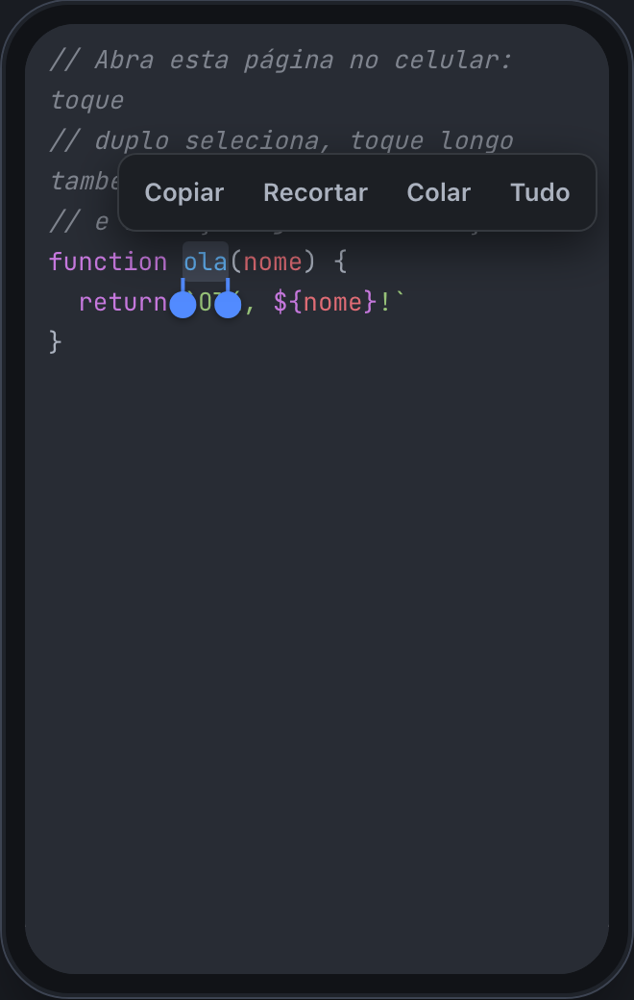

A rolagem é 100% nativa. A extensão `touch()` (no `basicSetup`) acrescenta:

- **Toque** posiciona o cursor e abre o teclado.
- **Toque duplo** ou **longo** seleciona a palavra.
- **Alças** arrastáveis ajustam a seleção.
- Uma **barra** com Copiar, Recortar, Colar e Tudo.

O núcleo cuida do teclado virtual: comandos chegam por `beforeinput`, e um caractere sentinela invisível no textarea garante que o Backspace seja reportado. O textarea usa 16px em telas de toque (sem o zoom automático do iOS), e o cursor volta à vista quando o teclado abre. Em telas estreitas, combine com `lineWrapping: true`.

**Validado no Android** (Chrome 133, Android 16, teclado Gboard, com toques e digitação injetados pelo sistema): posicionar o cursor, digitar, Enter com indentação, Backspace juntando linhas, sugestões do teclado, toque longo/duplo, alças, copiar e colar, rolagem nativa, quebra de linha e 100 mil linhas (35–56 ms para abrir com a CPU 4× mais lenta). O "Colar" da barra pede permissão de área de transferência ao Chrome na primeira vez; colar pelo teclado ou pelo sistema não pede. O iOS Safari ainda não foi testado. Para testar no seu aparelho, abra [`examples/mobile.html`](examples/mobile.html) pelo `npm run dev`.

<br clear="right">

## Acessibilidade

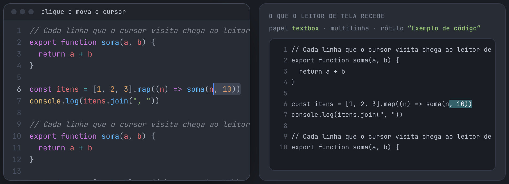

Leitores de tela leem campos de texto, não desenhos. Por isso o textarea invisível que recebe o teclado **espelha uma página de 10 linhas** em volta do cursor, com a mesma seleção: setas, palavras e seleções são anunciadas como num campo nativo, e o que você digita (inclusive por IME) é lido de volta comparando o textarea com o espelho.

- <kbd>Esc</kbd> e depois <kbd>Tab</kbd> tiram o foco do editor (o <kbd>Tab</kbd> sozinho indenta), então o teclado nunca fica preso.
- Os números de linha ficam fora da árvore de acessibilidade; o rótulo vem de `ariaLabel`.
- Em alto contraste (`forced-colors`), cursor, seleção e colchetes usam as cores do sistema; com `prefers-reduced-motion`, o cursor para de piscar.

Conferido na árvore de acessibilidade do Chrome (papel *textbox*, multilinha, com texto e seleção). Ainda falta testar com NVDA, JAWS, VoiceOver e TalkBack.

## Arquivos gigantes e logs

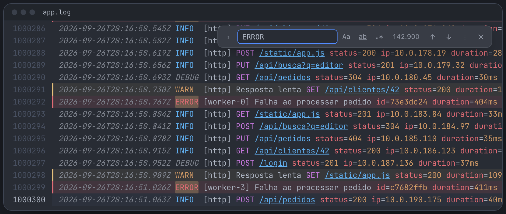

- **Mais de 1 milhão de linhas.** Os navegadores limitam a altura de um elemento (~17,9 milhões de px no Firefox): acima de 10 milhões de px o editor entra em modo compacto. A barra de rolagem mapeia proporcionalmente, as linhas desenhadas ganham um deslocamento, e roda do mouse, Page Up/Down e arraste continuam 1:1. Medido no Chrome (Apple M2): 1 milhão de linhas abrem em ~70 ms, 2 milhões em ~120 ms, 5 milhões em ~600 ms.
- **`editor.append(texto)`** acrescenta ao fim sem entrar no histórico e, se o fim estava na tela, continua seguindo, como `tail -f`.
- **`lineClass(fn)`** dá uma classe à linha inteira a partir do texto (níveis de log, diffs…), só para as linhas desenhadas.
- **`gotoLine()`** (no `basicSetup`): <kbd>Ctrl</kbd>+<kbd>G</kbd> aceita `120`, `120:8`, `+20` e `50%`.
- **A busca conta em segundo plano**, em fatias, e mostra o parcial (`12.345…`) enquanto conta; a posição (`3 / 142.857`) sai na hora.
- **A linguagem `log`** colore níveis, datas, IPs, URLs, ids e pilhas de erro.

```js
import { createEditor, basicSetup, lineClass } from 'jonacode'
import { log } from 'jonacode/languages/log'

const viewer = createEditor(el, {
  readOnly: true,
  language: log,
  extensions: [basicSetup(), lineClass((texto) => (/\bERROR\b/.test(texto) ? 'erro' : null))],
})
socket.onmessage = (e) => viewer.append('\n' + e.data)   // .jc-line-deco.erro { background: … }
```

A página [`examples/viewer.html`](examples/viewer.html) é um visualizador em tela cheia. A tokenização do que está fora da tela agora roda só no tempo ocioso do navegador (`requestIdleCallback`), então um salto para o meio de 100 mil linhas não atrasa o quadro seguinte.

## Marcações, tooltips, diagnósticos, autocomplete e folding

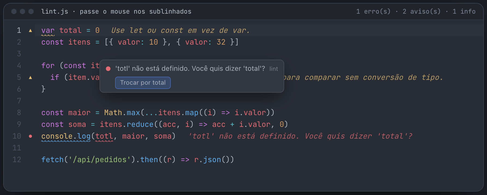

Os recursos que se espera de um editor, em versão leve: cada um é uma extensão importada à parte, e nenhum entra no `basicSetup` (assim ninguém paga por eles sem usar).

**Marcações** (+1,2 kB) são trechos, linhas e widgets desenhados atrás ou na frente do texto, em conjuntos com nome. Elas não mudam o layout, então a virtualização continua exata, e acompanham as edições. Para elementos com espaço próprio entre as linhas, veja [Zonas e widgets](#zonas-e-widgets).

```js
import { setDecorations, decorationsAt } from 'jonacode'

setDecorations(editor, 'revisao', [
  { from: { line: 3, col: 4 }, to: { line: 3, col: 12 }, class: 'destaque' },   // trecho (atrás do texto; above: true põe na frente)
  { from: { line: 7, col: 0 }, line: true, class: 'linha-alterada' },           // a linha inteira
  { from: { line: 7, col: 42 }, widget: () => criarBadge('revisar'), data: { autor: 'ana' } },
])
decorationsAt(editor, pos)   // o que está sob uma posição, com o `data` de cada uma
```

**Tooltips** (+1,5 kB): `hoverTooltip((pos, editor) => conteúdo)` aceita texto, um elemento ou uma Promise. Várias fontes dividem a mesma caixa, que fica na camada superior do navegador (Popover API), então nenhum `overflow: hidden` em volta a corta. `showTooltip(editor, pos, conteúdo)` mostra qualquer coisa, e `showHover` abre pelo teclado.

**Diagnósticos** (~4,8 kB com marcações e tooltips): o Jonacode não traz um linter. `setDiagnostics()` recebe o que o seu produzir, e `linter(fonte)` o roda depois de cada edição, com atraso e descartando respostas de um texto que já mudou. Aparecem como sublinhado ondulado na cor da severidade, marcador na margem, mensagem no fim da linha (`inline: true`) e tooltip com correções rápidas; <kbd>F8</kbd> / <kbd>Shift</kbd>+<kbd>F8</kbd> andam entre eles.

```js
import { linter } from 'jonacode'

linter((editor) => meuLinter(editor.getValue()).map((e) => ({
  from: e.inicio, to: e.fim, severity: 'error', message: e.mensagem, source: 'meu-linter',
  actions: [{ name: 'Corrigir', apply: (ed, d) => ed.dispatch({ changes: { from: d.from, to: d.to, insert: e.correcao } }) }],
})), { inline: true })
```

**Autocomplete** (~4,2 kB, sem LSP): sugere as palavras da linguagem no cursor (`completions` de cada gramática; dentro de um `<script>`, as de JavaScript) e as do documento perto do cursor. Suas fontes podem ser síncronas ou assíncronas: as rápidas aparecem na hora, as lentas se juntam quando chegam, e consultas velhas são canceladas por `AbortSignal`. A busca é aproximada (`gEBI` → `getElementById`). Abre ao digitar ou com <kbd>Ctrl</kbd>+<kbd>Espaço</kbd>, com papéis ARIA de listbox para leitores de tela, e aceita toque e o Enter do teclado virtual no celular.

```js
import { autocomplete, languageWords, documentWords } from 'jonacode'

autocomplete({
  sources: [
    languageWords(), documentWords(),
    async ({ word, signal }) => (await buscarProdutos(word.text, signal)).map((p) => ({ label: p.nome, type: 'text', detail: p.preco })),
  ],
})
```

**Folding** (+1,5 kB): `folding()` dobra blocos entre colchetes (mantendo a linha de fechamento visível), blocos por indentação (Python, YAML…) e seções de Markdown por título. As setas pulam as dobras; a busca e o "ir para a linha" as abrem; as dobras acompanham as edições. Atalhos: <kbd>Ctrl</kbd>+<kbd>Shift</kbd>+<kbd>[</kbd> / <kbd>]</kbd> (<kbd>⌘</kbd>+<kbd>⌥</kbd>+<kbd>[</kbd> / <kbd>]</kbd> no macOS) e <kbd>Ctrl</kbd>+<kbd>Alt</kbd>+<kbd>[</kbd> / <kbd>]</kbd> para tudo. O núcleo expõe o mecanismo: `editor.setFolds([{ from, to }])` e `editor.folds`.

## Zonas e widgets

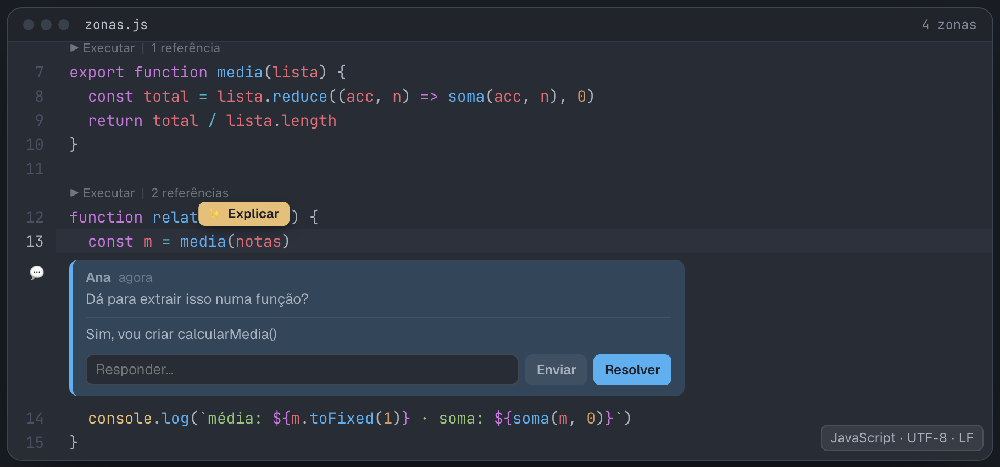

Para colocar elementos seus **entre as linhas**, use `addZone`: é o que o Monaco chama de *view zone*. A zona ocupa espaço próprio e as linhas de baixo descem, mas ela não faz parte do texto: o cursor pula por cima, copiar não a leva junto e a numeração continua certa.

```js
import { addZone, addWidget, addOverlay } from 'jonacode'

// Um texto acima da linha 5 (as linhas começam em zero)
addZone(editor, { line: 4, content: 'Calcula o frete com base no peso e na distância' })

// Uma barra de ações (como o CodeLens do VS Code), alinhada com o código da linha
addZone(editor, { line: 9, actions: [
  { label: '▶ Executar', run: (ed, zona) => rodar(zona.line) },
  { label: '3 referências', title: 'Mostrar referências', run: mostrarReferencias },
] })

// Qualquer elemento, abaixo da linha, com algo no gutter; a altura segue o conteúdo
const zona = addZone(editor, { line: 20, side: 'below', content: criarComentario(), gutter: '💬' })
zona.dom.querySelector('textarea').focus()   // já está na página, no lugar
zona.update({ line: 22 })                    // mover, trocar o conteúdo, a altura…
zona.remove()

// Flutuando sobre o texto, sem ocupar espaço (troca de lado quando não cabe); e fixo num canto
addWidget(editor, { pos: editor.selection.head, content: botao, place: 'above' })
addOverlay(editor, { content: 'JavaScript · UTF-8', position: 'bottom-right' })
```

| Opção de `addZone` | |
|---|---|
| `line` · `side` | A linha e o lado (`'above'`, o padrão, ou `'below'`). A zona acompanha as edições: <kbd>Enter</kbd> no começo da linha leva junto a zona de cima; no fim, a zona de baixo fica embaixo dela. |
| `content` · `actions` · `gutter` | Um elemento, um texto ou uma função que cria o elemento; uma barra de ações; algo no gutter ao lado. |
| `height` · `lines` | `'auto'` (padrão): mede o conteúdo e acompanha quando ele muda, antes da pintura. Ou px fixos, ou `lines: 2`, que cresce com a fonte. |
| `indent` · `cover` · `scroll` | Começar onde o código da linha começa (padrão com `actions`); cobrir também o gutter; rolar para o lado junto com o texto (por padrão a zona fica à vista). |
| `order` · `class` · `onHeight` | Ordem entre zonas do mesmo lado de uma linha, classe extra, aviso quando a altura muda. |

Cliques, campos e seleção de texto dentro de zonas, widgets e overlays são deles: o editor não mexe no cursor (vale também para qualquer elemento seu com a classe `jc-ui`). As zonas somem com a linha quando ela é dobrada e funcionam com quebra de linha, virtualização e qualquer tamanho de fonte. O módulo pesa +3,0 kB com os três. Por baixo estão `editor.setLineGaps(nome, lacunas)`, que reserva espaço em linhas ou em px acima/abaixo de linhas, e `addLayer({ fixed: true })`, uma camada que não rola para o lado. Os blocos de `setDecorations`, o diff inline e o merge usam a mesma base.

## Validação com tree-sitter

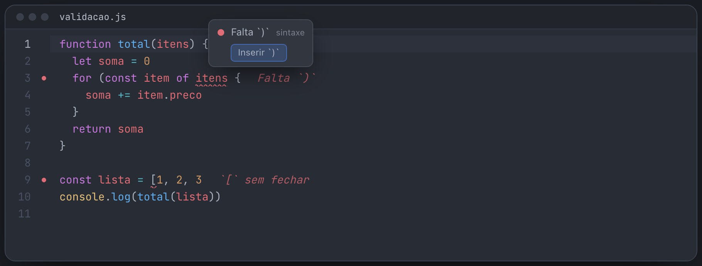

O destaque do Jonacode é um tokenizador rápido, não um parser: ele pinta, mas não sabe se o código é válido. `treeSitter()` roda o [tree-sitter](https://tree-sitter.github.io/) (o parser do GitHub, do Neovim e do Zed, em WebAssembly) ao lado do editor:

- **Validação:** erros de sintaxe viram diagnósticos (sublinhado, margem, tooltip, <kbd>F8</kbd>), cada fonte no seu conjunto, então convivem com os do seu linter.
- **Correção:** quando o deslize é claro, o tooltip oferece a correção. Pode inserir o `)` que falta, remover a vírgula sobrando no JSON, fechar o `[`, a string ou o `if` do bash (`fi`), ou pôr a vírgula que faltou entre duas linhas de um JSON. O fechamento vai para onde a indentação do bloco termina, não para o fim do arquivo, e `fixAllSyntax` aplica tudo num passo de desfazer.
- **Código aninhado:** `<script>` e `<style>` no HTML e blocos de código no Markdown são validados com a gramática deles.
- **Sem travar:** a análise é incremental e roda em tempo ocioso, em fatias de 6 ms. Num arquivo de 20 mil linhas, o pior quadro enquanto carrega, analisa e reanalisa ficou em 17–18 ms no Chromium e no Firefox e em até 30 ms no WebKit (um quadro são ~17 ms).
- **Árvore sintática:** `syntaxTree(editor)`, `nodeAt(editor, pos)`, e <kbd>Alt</kbd>+<kbd>Shift</kbd>+<kbd>→</kbd>/<kbd>←</kbd> (<kbd>⌃</kbd><kbd>⇧</kbd><kbd>⌘</kbd> no macOS) para expandir e encolher a seleção por nó.

O Jonacode não depende do tree-sitter: você entrega o `web-tree-sitter` e as gramáticas, e o seu bundler decide como carregar. A gramática é escolhida pelo `editor.language.name`, então você continua usando as mesmas linguagens:

```js
import { treeSitter, grammarsFrom, cdnGrammars, cdnTreeSitter } from 'jonacode/tree-sitter'

// Com bundler (npm i web-tree-sitter tree-sitter-javascript): um pedaço à parte, baixado quando o editor abre.
treeSitter({ load: () => import('web-tree-sitter'), grammars: { javascript: jsWasmUrl } })   // Vite: '…/tree-sitter-javascript.wasm?url'

// Os .wasm copiados para /wasm (GRAMMARS diz o pacote, a versão e o arquivo de cada um).
treeSitter({ load: () => import('web-tree-sitter'), grammars: grammarsFrom('/wasm/') })

// Sem instalar nada (protótipos, HTML puro com o bundle <script>): tudo da CDN.
treeSitter({ load: cdnTreeSitter, grammars: cdnGrammars() })
```

| Linguagem | Gramática | wasm (gzip) |
|---|---|---:|
| `javascript`, `jsx` | tree-sitter-javascript | 49 kB |
| `typescript` · `tsx` | tree-sitter-typescript | 136 · 139 kB |
| `json` · `css` · `html` (+ JS e CSS dentro) | tree-sitter-json · -css · -html | 2 · 21 · 7 kB |
| `shell` | tree-sitter-bash | 180 kB |
| `markdown` | nenhuma: os blocos de código usam a linguagem deles | — |
| `sql` | sem wasm pronto no npm: gere com `tree-sitter build --wasm` | — |

O módulo pesa +8,8 kB (com os diagnósticos); o `web-tree-sitter` são 31 kB de JavaScript e 81 kB de wasm (gzip), baixados uma vez por página. Para a IA, `editorTools(editor, { verify: getSyntaxProblems })` devolve os erros de sintaxe ao modelo depois de cada edição, e `createSyntaxChecker(opções).check(texto, 'javascript')` valida a resposta de um modelo antes de aplicá-la.

## Edição colaborativa

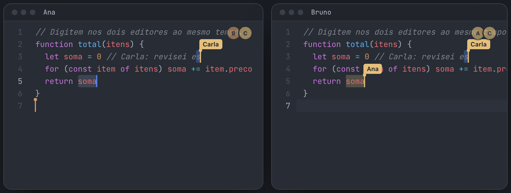

`collab(adaptador, opções)` transforma o editor num editor cooperativo: ele parte do texto compartilhado, envia as suas edições, aplica as dos outros e mostra quem está ali. O backend é um adaptador: `yjs()` já vem pronto e funciona com qualquer provedor do [Yjs](https://yjs.dev/) (y-websocket, Hocuspocus, y-webrtc, Liveblocks, PartyKit…), e um servidor seu entra implementando `CollabAdapter`. Como no tree-sitter, o Jonacode não importa o Yjs: você entrega o módulo.

```js
import * as Y from 'yjs'
import { WebsocketProvider } from 'y-websocket'
import { collab, yjs } from 'jonacode/collab'

const doc = new Y.Doc()
const provider = new WebsocketProvider('wss://seu-servidor', 'sala-42', doc)

createEditor(el, {
  extensions: [
    basicSetup(),
    collab(yjs({ Y, text: doc.getText('codigo'), awareness: provider.awareness }), {
      user: { name: 'Ana', color: '#c678dd' },
      labels: 'activity',     // nomes por um instante quando a pessoa mexe; ou 'always', 'hover', 'never'
      onPeers: (pessoas) => atualizarLista(pessoas),
    }),
  ],
})
```

- **Cursores e seleções** de cada pessoa, com nome e cor. Pessoas paradas há um minuto ficam esmaecidas.
- **Avatares** no canto do editor; clicar num **segue** a pessoa (a sua tela vai aonde ela vai, até você digitar, clicar ou rolar). `getPeers`, `followPeer` e `onPeers` dão o mesmo para a sua própria interface (`avatars: false`).
- **Destaque** rápido no que os outros acabaram de digitar.
- **Desfazer só o seu:** com Yjs usa o `Y.UndoManager`; com outros backends, um histórico próprio que se ajusta às edições alheias e descarta o passo que alguém editou por cima, em vez de apagar o trabalho dessa pessoa.
- **Compatível** com os cursores do y-codemirror e do y-monaco (mesmos campos no `awareness`).
- **Seguro:** edições dos outros passam pelos trechos protegidos (`readOnlyRanges` vale para quem digita aqui); se algo recusar uma delas, o editor recarrega o texto compartilhado em vez de divergir.

Um backend seu implementa `text()`, `send(ops)` (as suas edições em offsets: `[{ at, remove, insert }]`) e `receive(fn)` (as dos outros num delta `retain`/`insert`/`delete`, o formato do Yjs e do Quill); presença e desfazer são opcionais (`setPresence`, `peers`, `undo`). O módulo pesa +6,2 kB com o adaptador do Yjs; o Yjs (~25 kB gzip) e o provedor vêm do seu projeto. Numa sala nova, ponha o conteúdo inicial no `Y.Text` (uma vez, quando o provedor sincronizar), não no editor: senão, duas pessoas abrindo a sala juntas duplicariam o texto.

## IA

<table>
  <tr>
    <td width="50%">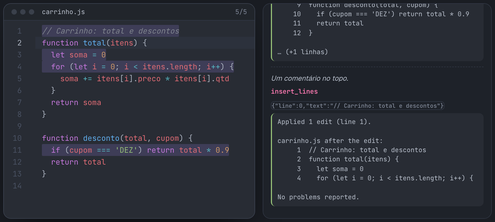</td>
    <td width="50%">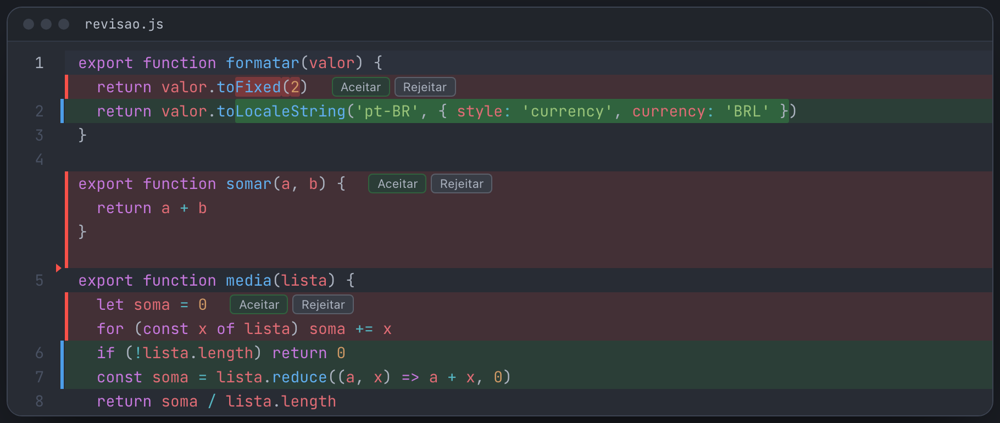</td>
  </tr>
  <tr>
    <td align="center"><sub>Um agente usando as ferramentas</sub></td>
    <td align="center"><sub>A pessoa revisa o que a IA mudou</sub></td>
  </tr>
</table>

Dois tipos de IA mexem num editor: a do seu produto, que você liga a um modelo, e a de fora, um agente de navegador que opera a página. O Jonacode atende os dois com peças opcionais e sem provedor preso: você decide qual modelo chamar e como. Tudo está em `jonacode` e agrupado em `jonacode/ai`.

### Ferramentas para agentes

`editorTools(editor)` devolve as definições das ferramentas e um `run(nome, entrada)` que as executa no editor: `read_file` (linhas numeradas; em arquivos enormes, o começo e um esboço para navegar), `search_file`, `edit_file`, `insert_lines`, `write_file`, `get_selection`, `get_problems` e `undo_last_edit` (só desfaz o que a IA fez, e só se ninguém mexeu depois). Os erros são escritos para o modelo entender e tentar de novo, cada edição é um passo de desfazer, e depois de editar as ferramentas esperam o linter e devolvem os problemas, para o modelo corrigir sozinho. Aceita vários arquivos (`{ 'index.html': ed1, 'app.js': ed2 }`).

```js
import { editorTools } from 'jonacode/ai'

const tools = editorTools(editor)
const mensagens = [{ role: 'user', content: 'Corrija os erros deste arquivo.' }]

while (true) {
  // A chave da API fica no servidor: o navegador só repassa mensagens e ferramentas.
  const resposta = await fetch('/api/claude', {
    method: 'POST',
    body: JSON.stringify({ messages: mensagens, tools: tools.anthropic({ textEditor: true }) }),
  }).then((r) => r.json())
  mensagens.push({ role: 'assistant', content: resposta.content })
  if (resposta.stop_reason !== 'tool_use') break

  const resultados = []
  for (const bloco of resposta.content) {
    if (bloco.type !== 'tool_use') continue
    const { content, isError } = await tools.run(bloco.name, bloco.input)
    resultados.push({ type: 'tool_result', tool_use_id: bloco.id, content, is_error: isError })
  }
  mensagens.push({ role: 'user', content: resultados })
}
```

```ts
// servidor.ts — com o SDK oficial da Anthropic
import Anthropic from '@anthropic-ai/sdk'

const client = new Anthropic()   // lê ANTHROPIC_API_KEY do ambiente

export async function POST(req: Request) {
  const { messages, tools } = await req.json()
  const resposta = await client.beta.messages.create({
    model: 'claude-opus-5-5',
    max_tokens: 16000,
    thinking: { type: 'adaptive' },
    betas: ['server-side-fallback-2026-07-01'],
    fallbacks: 'default',   // se o modelo recusar, outro assume a mesma chamada
    tools,
    messages,
  })
  return Response.json(resposta)
}
```

Com `{ textEditor: true }` o Claude recebe a ferramenta de edição de texto que ele já conhece (`str_replace_based_edit_tool`: `view`, `str_replace`, `insert`, `create`) e `run()` a executa no editor. `tools.openai()` e `tools.definitions` (formato MCP, com `inputSchema`) servem para outros provedores. `describeEditor(editor)` e `fimContext(editor)` montam contexto para prompts sem mandar o arquivo inteiro.

### Edições no formato da IA

Modelos erram número de linha e coluna, mas escrevem bem blocos "procurar e substituir", diffs e arquivos inteiros. `applyEdits(editor, resposta)` aceita os três (inclusive com texto em volta e cercas de código) e tolera os deslizes comuns: indentação trocada, espaços no fim da linha, número de linha errado no diff, texto quase igual (com um limite de semelhança). Recusa o que apagaria código por engano, como `// ... resto do código` no lugar do código ou uma resposta que não tem nada a ver com o arquivo. Aplica tudo ou nada, num passo de desfazer, e só muda o que mudou de fato.

```js
import { applyEdits } from 'jonacode/ai'

const r = applyEdits(editor, textoDoModelo)
r.ok        // tudo aplicado?
r.summary   // "Applied 2 edits (lines 12–18, 40)." ou o erro, pronto para devolver ao modelo:
            // "…not found; the most similar text is at line 212 (86% similar): …"
r.ranges    // onde o texto novo ficou (markAIEdits(editor, r.ranges) destaca)
```

### Revisão com diff

`diffView({ original })` compara o documento com um texto anterior: as linhas removidas aparecem em blocos entre as linhas, com as cores da linguagem, as novas ficam em verde, o que mudou dentro da linha é marcado, e cada trecho tem Aceitar e Rejeitar (também <kbd>F7</kbd> para andar entre eles). Rejeitar é um passo de desfazer. Num arquivo de 100 mil linhas, cada tecla custa menos de 2 ms a mais. `mergeView(el, { a, b })` mostra dois editores lado a lado, alinhados, com rolagem sincronizada e setas para reverter.

```js
import { diffView, setOriginal } from 'jonacode'

const editor = createEditor(el, { extensions: [basicSetup(), diffView({ original: salvo })] })

const antes = editor.getValue()
await agente(editor)            // a IA edita…
setOriginal(editor, antes)      // …e a pessoa revisa trecho a trecho
```

Os blocos são uma peça nova do núcleo e estão abertos para você: `setDecorations(editor, 'x', [{ from, block: 'above', lines: 2, widget }])` reserva linhas acima ou abaixo de uma linha para qualquer elemento (comentários de revisão, prévias…), e a virtualização conta com elas.

### Sugestões e Ctrl/⌘+K

`inlineSuggestion(fonte)` mostra o texto fantasma estilo Copilot: <kbd>Tab</kbd> aceita, <kbd>Ctrl</kbd>/<kbd>⌘</kbd>+<kbd>→</kbd> aceita uma palavra, <kbd>Esc</kbd> descarta, e digitar o que a sugestão diz continua com ela. `inlineEdit(fonte)` abre com <kbd>Ctrl</kbd>/<kbd>⌘</kbd>+<kbd>K</kbd> uma caixa entre as linhas para pedir uma mudança na seleção; a resposta aparece em tempo real num bloco abaixo, sem mexer no documento, e entra de uma vez quando termina. As duas fontes podem devolver uma string, uma Promise ou um stream (async iterable), e recebem um `AbortSignal`.

```js
import { inlineSuggestion, inlineEdit } from 'jonacode/ai'
import { setOriginal } from 'jonacode'

inlineSuggestion(async function* ({ prefix, suffix, language }, signal) {
  const res = await fetch('/api/completar', { method: 'POST', body: JSON.stringify({ prefix, suffix, language }), signal })
  for await (const pedaço of res.body.pipeThrough(new TextDecoderStream())) yield pedaço
})

inlineEdit(({ instruction, text, before, after }, signal) => pedirAoModelo({ instruction, text }, signal), {
  onApply: (editor, antes) => setOriginal(editor, antes),   // a mudança vai para a revisão do diffView
})
```

### Agentes de navegador

Editores virtualizados costumam ser hostis a agentes que operam a página: só as linhas na tela existem no DOM, e o campo escondido guarda só um pedaço. O Jonacode trata os três caminhos que esses agentes usam:

- **Preencher o campo:** quando um script ou uma ferramenta de automação seleciona o campo inteiro e digita (o `fill` do Playwright, o "preencher" de um agente), isso vale pelo documento inteiro, num passo de desfazer. Se o script só alterou a página que leu do campo, só ela muda.
- **Ler a árvore de acessibilidade:** o campo diz que é uma parte do arquivo (`aria-description="Lines 21–30 of 200"`, traduzível).
- **Chamar ferramentas:** `exposeTools(editorTools(editor))` registra as ferramentas na proposta [WebMCP](https://github.com/webmachinelearning/webmcp) quando o navegador a oferece (ainda experimental); sem ela, não faz nada.

### Proteções e verificação

`readOnlyRanges([...])` protege trechos que ninguém edita, nem a pessoa nem a IA (exercícios com "só edite dentro da função", modelos de CMS); uma edição da IA que toque neles falha com uma mensagem clara. O núcleo ganhou para isso `editor.addChangeFilter(fn)`, que deixa qualquer extensão vetar uma transação.

```js
import { readOnlyRanges, lineRange } from 'jonacode'
import { editorTools } from 'jonacode/ai'

createEditor(el, { extensions: [basicSetup(), linter(meuLinter), readOnlyRanges([protegido])] })
const tools = editorTools(editor, { verify: (ed) => meuLinter(ed) })   // problemas voltam ao modelo depois de cada edição
```

## Temas

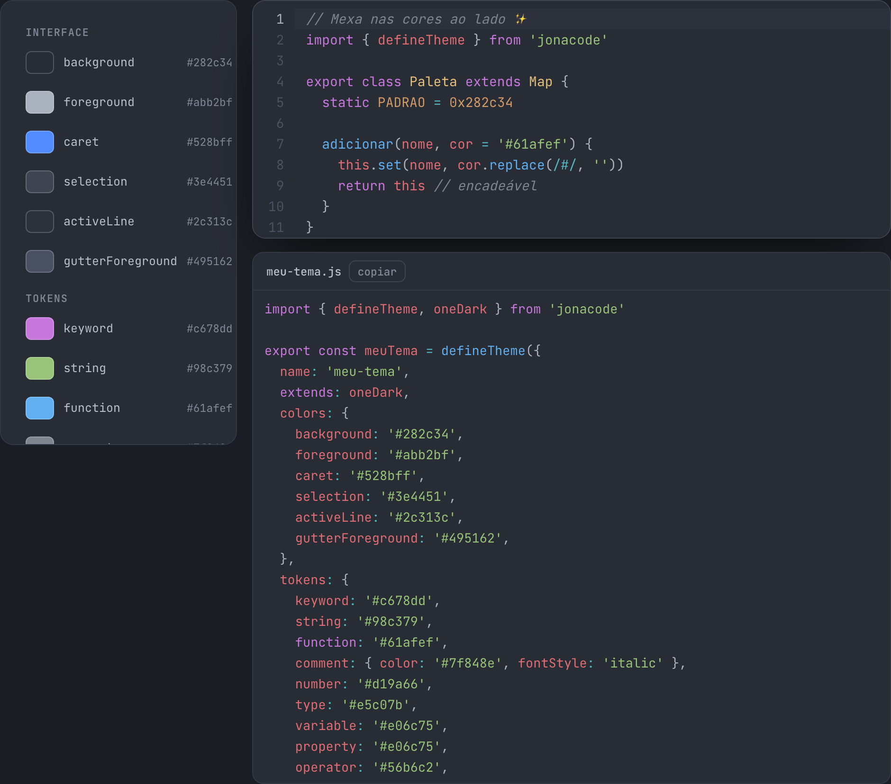

Um tema é um objeto compilado para CSS com escopo: cores da interface viram **variáveis CSS** e tokens viram **classes**. Escopos com ponto têm fallback: `string.escape` usa `string` se o tema não definir o mais específico.

```js
import { defineTheme, oneDark } from 'jonacode'

export const meuTema = defineTheme({
  name: 'meu-tema',
  extends: oneDark,                          // herda tudo
  colors: { background: '#0d1117', selection: '#264f78' },
  tokens: {
    keyword: { color: '#ff7b72', fontWeight: 'bold' },
    string: '#a5d6ff',
    comment: { color: '#8b949e', fontStyle: 'italic' },
  },
})

editor.setOptions({ theme: meuTema })
```

Cores não informadas são derivadas de `background`/`foreground` com `color-mix()`, então um tema mínimo precisa só dessas duas e dos tokens. Também dá para sobrescrever direto no CSS:

```css
.meu-app .jc-editor {
  --jc-bg: #1e1e2e;
  --jc-caret: #f5c2e7;
  --jc-font-size: 15px;
  --jc-font-family: 'Fira Code', monospace;
}
```

Temas incluídos: `oneDark` (padrão, em `jonacode`) e `oneLight` (em `jonacode/themes/one-light`). Tokens estilizados: `keyword`, `comment`, `string`, `string.escape`, `number`, `constant`, `operator`, `punctuation`, `variable`, `property`, `function`, `type`, `regexp`, `meta`, `tag`, `attribute`, `invalid`, entre outros.

### Temas do VS Code

```js
import { fromVSCodeTheme } from 'jonacode/themes/vscode'
import tema from './dracula-color-theme.json'      // ou o texto do arquivo (JSONC é aceito)

createEditor(el, { theme: fromVSCodeTheme(tema) })
fromVSCodeTheme(texto, { include: (caminho) => arquivos[caminho] })   // temas com "include"
```

As cores da interface vêm de `colors` e as dos tokens de `tokenColors`, com os escopos TextMate resolvidos como no VS Code (o seletor mais específico que é prefixo do escopo vence). Comparado caractere a caractere com o próprio VS Code nos 19 temas que vêm com ele, 75% do texto sai com a mesma cor (82% no Dark+). O resto vem de regras por linguagem que um mapeamento de uma cor por tipo não reproduz; o teto medido é 77%.

## Linguagens

Uma linguagem é uma **máquina de estados declarativa**: cada estado tem uma lista ordenada de regras (regex + token), e regras podem empilhar (`push`), desempilhar (`pop`) ou trocar (`next`) de estado. É assim que comentários de várias linhas e template strings aninhadas funcionam.

```js
import { defineLanguage, words } from 'jonacode'

export const jonalang = defineLanguage({
  name: 'jonalang',
  comments: { line: '#' },                  // usado pelo Mod-/
  brackets: [['{', '}'], ['(', ')']],       // bracket matching e auto-indent
  states: {
    root: [
      [/#.*/, 'comment'],
      [/"/, 'string', '@texto'],            // '@nome' empilha um estado
      [/\d+(,\d+)?/, 'number'],
      [/(funcao)(\s+)(\w+)/, ['keyword', null, 'function']],   // um token por grupo
      {
        match: /[\wà-ú]+/,
        token: words({
          keyword: ['se', 'senao', 'enquanto', 'retorne', 'var'],
          'constant.language': ['verdadeiro', 'falso', 'nulo'],
        }, 'variable'),
      },
    ],
    texto: [
      [/\{[^}]*\}/, 'punctuation.special'], // interpolação {nome}
      [/[^"{]+/, 'string'],
      [/"/, 'string', '@pop'],              // volta ao estado anterior
    ],
  },
})
```

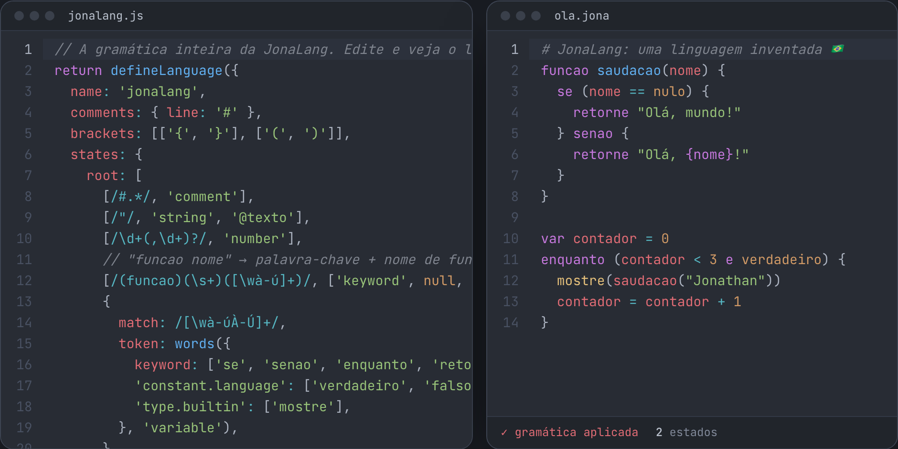

- **Formas de regra:** tupla `[regex, token, ação]` ou objeto `{ match, token, push, pop, next }`. `{ include: 'estado' }` reaproveita regras.
- **Tokens calculados:** `token` pode ser uma função `(texto, { line, from, to }) => tipo`. A gramática JavaScript usa isso para saber se um identificador é função, propriedade ou tipo.
- **Linguagens embutidas:** uma regra com `embed` entrega o texto seguinte a outra linguagem (veja [abaixo](#uma-linguagem-dentro-da-outra)).
- **Comportamento de edição:** `comments`, `brackets`, `closePairs`, `indent.increase`/`indent.decrease` e `wordChars`.

As gramáticas prontas exportam suas specs (`javascriptSpec`, `typescriptSpec`, `htmlSpec()`…), então dá para derivar uma variante sua com `extendLanguage` ou `defineLanguage({ ...javascriptSpec, ... })`.

### Linguagens prontas

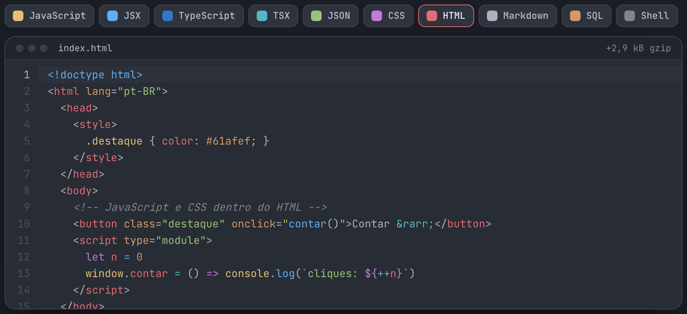

Cada linguagem é um módulo próprio: importe só as que usar. Tamanho é o que cada uma soma ao bundle (minificado + gzip, com tree-shaking):

| Linguagem | Import | gzip |
|---|---|---:|
| JavaScript | `import { javascript } from 'jonacode/languages/javascript'` | 1,7 kB |
| JSX | `import { jsx } from 'jonacode/languages/javascript'` | 2,2 kB |
| TypeScript | `import { typescript } from 'jonacode/languages/typescript'` | 2,8 kB |
| TSX | `import { tsx } from 'jonacode/languages/typescript'` | 3,3 kB |
| JSON (e JSONC) | `import { json } from 'jonacode/languages/json'` | 0,5 kB |
| CSS (com aninhamento) | `import { css } from 'jonacode/languages/css'` | 1,3 kB |
| HTML (com JS e CSS) | `import { html, createHtml } from 'jonacode/languages/html'` | 3,6 kB |
| Markdown | `import { markdown, createMarkdown } from 'jonacode/languages/markdown'` | 1,2 kB |
| SQL | `import { sql } from 'jonacode/languages/sql'` | 1,7 kB |
| Shell (bash) | `import { shell } from 'jonacode/languages/shell'` | 2,0 kB |
| Log | `import { log } from 'jonacode/languages/log'` | 1,3 kB |

```js
import { createMarkdown } from 'jonacode/languages/markdown'
import { createHtml } from 'jonacode/languages/html'
import { typescript } from 'jonacode/languages/typescript'
import { css } from 'jonacode/languages/css'

// Markdown com cor nos blocos ```ts e ```css (escolhidos por nome, alias ou extensão)
const markdown = createMarkdown({ codeLanguages: [typescript, css] })
// HTML com TypeScript nos <script>
const html = createHtml({ script: typescript })
```

Sem bundler, `dist/jonacode.languages.iife.min.js` (~10 kB gzip) acrescenta todas ao global `Jonacode`, reaproveitando o núcleo do `jonacode.iife.min.js`.

### Uma linguagem dentro da outra

Uma regra com `embed` entrega o texto seguinte a outra linguagem até o marcador de fim. O marcador não é consumido: quem o destaca é a linguagem de fora.

```js
// HTML: depois do ">" de <script>, JavaScript até "</script"
{ match: '>', token: 'punctuation.tag', pop: true, embed: { language: javascript, end: /<\/script/i } }

// Markdown: a linguagem e o fim dependem da abertura (```` só fecha com ````)
{
  match: /^(`{3,})(\w*)$/, token: ['punctuation.special', 'type'], push: 'fence',
  embed: {
    language: (m) => findLanguage([javascript, css], m[2]),
    end: (m) => new RegExp(`^${m[1]}\\s*$`),
  },
}
```

A pilha de estados ganha um degrau que guarda o estado da linguagem de dentro. O degrau também é internado, então a tokenização incremental converge como antes. `editor.languageAt(pos)` diz a linguagem no ponto, e é ela que decide o comentário do <kbd>Mod</kbd>+<kbd>/</kbd>, a indentação e os pares que fecham sozinhos.

### Gramáticas do Monaco

```js
import { fromMonarch } from 'jonacode/monarch'
// o objeto `language` (e o `conf`, se quiser) de monaco-editor/esm/vs/basic-languages/python/python.js
import { language, conf } from './python.js'

const python = fromMonarch(language, { name: 'python', conf })
```

`fromMonarch()` tem um tokenizador próprio que segue a semântica do Monarch: atributos (`@keywords`), `cases`, `@push`/`@pop`/`@popall`, subestados com `$S2`, `@rematch`, grupos e `nextEmbedded`. Os nomes de token são convertidos para os dos nossos temas (`identifier` → `variable`, `delimiter` → `punctuation`…), e `tokenMap` ajusta. Validado contra o lexer do próprio Monaco: as 81 gramáticas compilam, e em 16.809 linhas de código real de 49 linguagens os tokens são **100% iguais**, com a tokenização ~2× mais rápida. Custa 3,1 kB gzip, só se importado. (Alguns arquivos do Monaco importam a API do editor só por causa do `conf`: copie o objeto `language`.)

### Testando gramáticas

```js
import { test } from 'node:test'
import { expectTokens, describeTokens } from 'jonacode/testing'

test('jonalang', () => {
  expectTokens(jonalang, `
    funcao ola(nome) {
    ^^^^^^ keyword
           ^^^ function
  `)
})

describeTokens(jonalang, codigo)   // gera esse formato a partir de um exemplo, para revisar e colar
```

Funciona com qualquer executor de testes (só lança um `Error`). Quando um token não confere, a mensagem mostra a linha, o esperado, o encontrado e o bloco certo para copiar. O **[laboratório](docs/lab.html)** junta tudo: gramática nos formatos Jonacode ou Monarch, exemplo ao vivo com inspetor de tokens, tokens da linha, pilha no cursor, testes gerados e rodados ali, e exportação do módulo e dos testes.

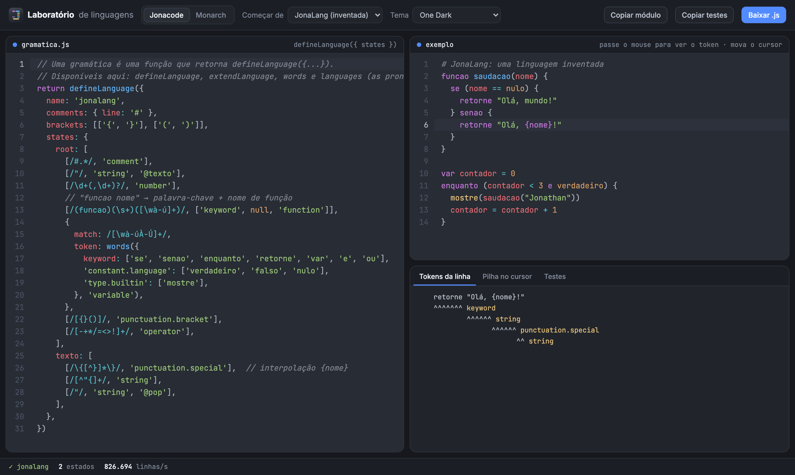

## Tokens personalizados

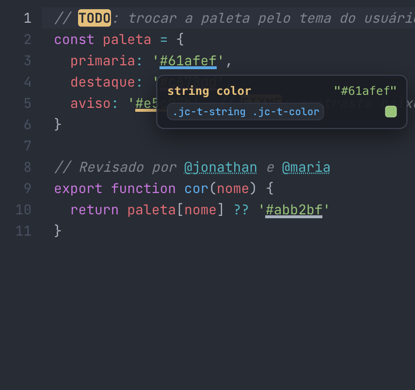

Precisa de um tipo de token novo (`todo`, `url`, `cor`, `mencao`…)? Capture e estilize em duas linhas, sem mexer na gramática:

```js
import { tokenRule, tokenStyles, tokenInspector } from 'jonacode'

createEditor(el, {
  language: javascript,
  extensions: [
    basicSetup(),
    // captura: só dentro de comentários, mantendo o tipo original ("comment todo")
    tokenRule({ match: /\b(TODO|FIXME)\b/, token: 'todo', inside: 'comment' }),
    // CSS por token: a cor vira uma variável usada no estilo
    tokenRule({ match: /#[\da-f]{6}\b/i, token: 'color', inside: 'string', style: (m) => `--swatch:${m[0]}` }),
    // estilo: qualquer propriedade CSS, só neste editor, por cima do tema
    tokenStyles({
      'comment todo': { background: '#e5c07b', color: '#282c34', fontWeight: 'bold', borderRadius: '3px' },
      'string color': 'box-shadow: inset 0 -3px var(--swatch)',
    }),
    tokenInspector(), // ferramenta de dev: passe o mouse para ver tipo e classe
  ],
})
```

- **Onde estilizar:** `tokenStyles` (por editor), `tokens` no tema (`defineTheme`) ou CSS puro: `.jc-t-todo { … }`, `.jc-t-comment.jc-t-todo { … }`.
- **Na gramática:** qualquer regra pode emitir qualquer nome, e `extendLanguage(javascript, { prepend: { root: [...] } })` adiciona regras a uma linguagem existente. Use-o quando o token novo muda estados (ex.: SQL dentro de ``sql`…` ``). Para marcar trechos dentro de tokens existentes, prefira `tokenRule`.
- **Cuidado:** evite propriedades que mudam a largura do texto (`padding`, `margin`, `letter-spacing`, `font-size`): o editor mede a fonte uma vez para todo o texto, então um token mais largo que os outros desalinha o cursor dali em diante. Fundo, `box-shadow`, `outline`, cor, sublinhado, itálico e negrito são seguros.

## Extensões

Uma extensão é uma função que recebe o editor e usa a API pública. Tudo o que ela registra é desfeito em `setExtensions()` ou `destroy()`.

```js
// Destaca TODOs: uma camada que desenha só nas linhas renderizadas
function highlightTodos() {
  return (editor) => editor.addLayer({
    className: 'todos',
    render(dom, ed) {
      const { from, to } = ed.visibleRange
      let html = ''
      for (let line = from; line <= to; line++) {
        const col = ed.doc.line(line).indexOf('TODO')
        if (col < 0) continue
        const a = ed.coordsAtPos({ line, col })
        const b = ed.coordsAtPos({ line, col: col + 4 })
        html += `<div class="todo" style="left:${a.x}px;top:${a.top}px;width:${b.x - a.x}px"></div>`
      }
      dom.innerHTML = html
    },
  })
}

createEditor(host, { extensions: [highlightTodos(), basicSetup()] })
```

| Ponto de extensão | Para quê |
|---|---|
| `addKeymap(bindings, 'high'?)` | Atalhos (`Mod` = ⌘ no macOS, Ctrl no resto). |
| `addInputHandler(fn)` | Intercepta texto digitado (é assim que o `closeBrackets` funciona). |
| `addGutter({ cell, width, onMouseDown })` | Colunas à esquerda, virtualizadas com as linhas (números, breakpoints…). |
| `addLayer({ render, above, order })` | Desenho abaixo ou acima do texto (seleção, bracket matching, linha ativa…). |
| `addTokenTransform(fn)` | Reescreve os tokens de cada linha antes de pintar (é assim que o `tokenRule` funciona). |
| `addCursorModifier({ kind, test })` · `addMouseHandler(fn)` | Modificadores do mouse para cursores extras e cliques personalizados. |
| `on(evento, fn)` | Eventos do editor. |

| `addChangeFilter(fn)` | Veta transações antes de entrarem (é assim que o `readOnlyRanges` funciona). |
| `setLineGaps(chave, [{ line, above, below }])` | Reserva linhas vazias entre as linhas, contadas pela virtualização (é onde os blocos do `setDecorations` entram). |

Extensões incluídas: `lineNumbers()`, `highlightActiveLine()`, `bracketMatching()`, `closeBrackets()`, `keymap(bindings)`, `multiCursor()`, `search()`, `gotoLine()`, `touch()`, `lineClass(fn)`, `tokenRule()`, `tokenStyles()`, `tokenInspector()`, `onChange(fn)`, `folding()`, `autocomplete()`, `diagnostics()`/`linter()`, `hoverTooltip()`, `readOnlyRanges()`, `diffView()`, e o atalho `basicSetup()`. As de IA estão em [IA](#ia).

## Como funciona por dentro

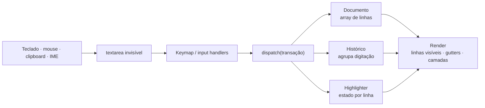

**1. Lista virtualizada.** A altura total é `linhas × alturaDaLinha`, então a barra de rolagem é real, mas só a janela visível (mais uma margem) existe no DOM. Cada elemento de linha tem uma chave `estadoInicial + texto`: ao rolar ou editar, elementos com a mesma chave são só reposicionados, e apenas o que mudou é reconstruído.

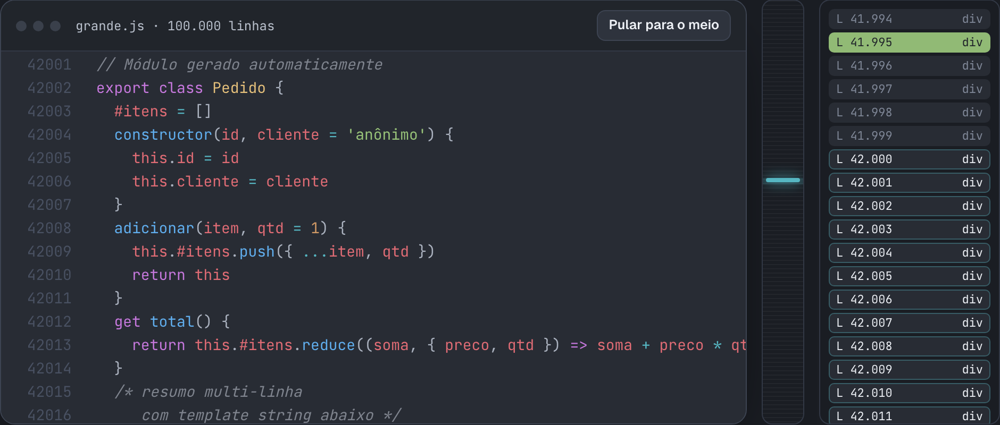

**2. Tokenização incremental.** O highlighter guarda o estado no início de cada linha. Uma edição invalida a partir da linha editada, e a re-tokenização para assim que o estado recalculado bate com o antigo. Os estados são **internados** (pilhas iguais são o mesmo objeto), então a comparação é um `===`. O trabalho é preguiçoso (só até a última linha visível) e o resto roda em fatias de ~12 ms em segundo plano.

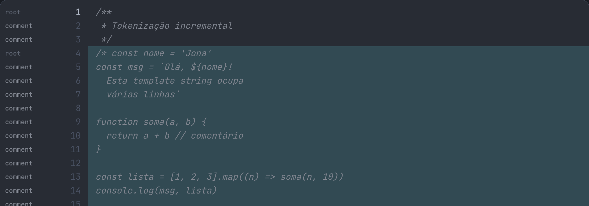

**3. O tokenizador.** Na posição atual, as regras do estado do topo são testadas em ordem com regex *sticky* (`/y`). A primeira que casar emite o token e aplica sua ação na pilha. Casamentos vazios só valem se mudarem o estado (e há proteção contra laços).

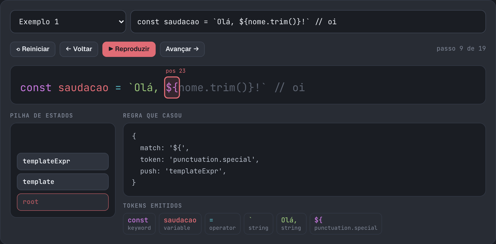

**Pintura dos tokens.** O caminho mais quente do editor tem várias otimizações:

- **Despacho pelo primeiro caractere:** cada regex é analisada na definição da linguagem para descobrir quais caracteres ASCII podem iniciar um casamento, e numa posição só são testadas as regras possíveis. Na gramática JavaScript, para um identificador só **1 das 16** regras roda. Resultado: **1,8×** mais linhas por segundo (303 mil → 549 mil em código real), com saída idêntica.
- **Reaproveitamento por chave** (texto, estado inicial e layout), comparada campo a campo, sem montar strings.
- **Cache LRU do HTML** das últimas 2.500 linhas: rolar para cima e para baixo não re-tokeniza.
- **Um `innerHTML` por linha**, tokens adjacentes já mesclados e `contain: layout style`.
- Medido no navegador: um render completo leva **~0,5 ms** num salto dentro de 100 mil linhas e **~0,2 ms** num passo de rolagem.

**4. Entrada de texto.** O texto exibido não é editável: é só DOM desenhado. Quem recebe o teclado é um `<textarea>` invisível que acompanha o cursor. Isso traz IME, clipboard e o menu de contexto nativo sem as armadilhas do `contenteditable`.

**5. Geometria.** Para linhas ASCII numa fonte monoespaçada (a maioria em código), coluna ↔ pixel é aritmética: `x = colunaVisual × larguraDoCaractere`, com tabs expandidos. Linhas com emoji ou CJK, ou qualquer linha numa fonte proporcional, são medidas com um `Range` do DOM, com busca binária no clique. O cursor anda por grafemas (`👍🏽` é um passo, não quatro), e as medidas funcionam mesmo com `transform: scale()` nos ancestrais. As alturas das linhas (linhas quebradas, dobras, zonas) ficam num mapa em px com somas prefixadas.

**Múltiplos cursores.** Os comandos são escritos para um cursor e rodam em todos com `changeByRange`: cada chamada enxerga o documento com as mudanças dos cursores anteriores, e os ranges finais são mapeados pelas mudanças dos cursores seguintes. Tudo vira uma única transação.

**6. Histórico.** Cada transação guarda as mudanças aplicadas (com o texto removido), e desfazer aplica o inverso em ordem reversa. Digitação contínua com a mesma origem, em menos de 600 ms e no mesmo ponto, vira um único passo.

**7. Tree-shaking.** O núcleo não importa nenhuma linguagem nem extensão. Linguagens e temas extras ficam em entradas separadas e o pacote é `sideEffects: false`.

## Tamanho

Medido com esbuild (minificado + gzip), com `npm run size`:

| Import | min | gzip |
|---|---:|---:|
| `createEditor` (núcleo + One Dark) | 78,4 kB | **26,8 kB** |
| + `basicSetup()` | 112,9 kB | 37,8 kB |
| + `basicSetup()` + JavaScript | 117,0 kB | 39,5 kB |
| Todas as 11 linguagens (além do núcleo, com as listas do autocomplete) | 29,4 kB | 10,1 kB |
| Só `highlight()` + JavaScript + One Dark (sem editor) | — | ~6,6 kB |
| `setDecorations` · `hoverTooltip` · `folding` | — | +1,2 · +1,5 · +1,5 kB |
| `addZone` + `addWidget` + `addOverlay` | — | +3,0 kB |
| `diagnostics`/`linter` · `autocomplete` (cada um já com o que precisa) | — | +4,8 · +4,2 kB |
| `fromMonarch` · `fromVSCodeTheme` · `lazyEditor` | — | +3,1 · +1,7 · +1,5 kB |
| `readOnlyRanges` · `diffView` · `mergeView` | — | +1,9 · +5,7 · +4,4 kB |
| `applyEdits` · `editorTools` (com `applyEdits`, marcações e contexto) | — | +5,7 · +11,8 kB |
| `inlineSuggestion` · `inlineEdit` | — | +3,3 · +4,5 kB |
| `treeSitter` (com os diagnósticos; o `web-tree-sitter` e as gramáticas vêm à parte) | — | +8,8 kB |
| `collab` + `yjs` (o Yjs e o provedor vêm à parte) | — | +6,3 kB |

O núcleo já inclui múltiplos ranges, quebra de linha, o suporte a teclado virtual, a virtualização pela página, o modo compacto para milhões de linhas, o espelho para leitores de tela, o aninhamento de linguagens, o mecanismo de dobras, os espaços para blocos e zonas entre linhas, a medição de fontes proporcionais e a entrada segura para agentes que preenchem o campo. Os módulos de IA pesam mais que as outras extensões (as descrições das ferramentas e as mensagens de erro são texto para o modelo), mas só entram se você importar. `npm run size:check` falha o CI se algum cenário passar do orçamento em `size-budget.json`. A busca (dentro do `basicSetup`) pesa 6,3 kB desde que ganhou a busca em várias linhas. Busca (+3,5 kB), múltiplos cursores (+0,6 kB), toque (+1,6 kB) e tokens personalizados (+0,5 kB) só entram se você importar.

## Atalhos

`Mod` = <kbd>⌘</kbd> no macOS e <kbd>Ctrl</kbd> no resto.

| Atalho | Ação |
|---|---|
| <kbd>Mod</kbd> <kbd>Z</kbd> · <kbd>Mod</kbd> <kbd>Shift</kbd> <kbd>Z</kbd> | Desfazer · refazer |
| <kbd>Tab</kbd> · <kbd>Shift</kbd> <kbd>Tab</kbd> | Indentar · desindentar |
| <kbd>Enter</kbd> | Nova linha com auto-indentação (e `{\|}` vira três linhas) |
| <kbd>Home</kbd> | Início inteligente (indentação ↔ coluna 0) |
| <kbd>Alt</kbd> <kbd>←</kbd>/<kbd>→</kbd> (macOS) · <kbd>Ctrl</kbd> <kbd>←</kbd>/<kbd>→</kbd> | Pular palavra |
| <kbd>Mod</kbd> <kbd>/</kbd> | Comentar / descomentar ¹ |
| <kbd>Alt</kbd> <kbd>↑</kbd>/<kbd>↓</kbd> | Mover linha(s) ¹ |
| <kbd>Shift</kbd> <kbd>Alt</kbd> <kbd>↑</kbd>/<kbd>↓</kbd> | Duplicar linha(s) ¹ |
| <kbd>Mod</kbd> <kbd>Shift</kbd> <kbd>K</kbd> | Apagar linha(s) ¹ |
| <kbd>Mod</kbd> <kbd>Enter</kbd> · <kbd>Mod</kbd> <kbd>Shift</kbd> <kbd>Enter</kbd> | Nova linha abaixo · acima ¹ |
| <kbd>Mod</kbd> <kbd>L</kbd> · <kbd>Mod</kbd> <kbd>]</kbd> · <kbd>Mod</kbd> <kbd>[</kbd> | Selecionar linha · indentar · desindentar ¹ |
| <kbd>Mod</kbd> <kbd>D</kbd> · <kbd>Mod</kbd> <kbd>Shift</kbd> <kbd>L</kbd> | Próxima ocorrência · todas as ocorrências ² |
| <kbd>Mod</kbd> <kbd>Alt</kbd> <kbd>↑</kbd>/<kbd>↓</kbd> · <kbd>Esc</kbd> | Cursor acima/abaixo · voltar a um cursor ² |
| <kbd>Mod</kbd> <kbd>F</kbd> · <kbd>Mod</kbd> <kbd>Alt</kbd> <kbd>F</kbd> · <kbd>F3</kbd> | Buscar · substituir · próxima ³ |

¹ `editingKeymap` · ² `multiCursor()` · ³ `search()`, todos incluídos no `basicSetup()`. Sem seleção, copiar/recortar agem na linha inteira (como no VS Code). A lista completa está na documentação.

## Desenvolvimento

```bash
npm install
npm run dev        # compila em watch e serve o playground em http://localhost:5173/examples/ (e mobile.html, viewer.html)
npm test           # testes (node:test, sem dependências)
npm run build      # dist/ (ESM + .d.ts) e o bundle IIFE
npm run docs       # gera docs/index.html e docs/lab.html (arquivos únicos)
npm run size       # tamanhos reais com tree-shaking (size:check compara com o orçamento)
npm run e2e        # Playwright em Chromium, Firefox e WebKit (+ toque no Chromium móvel); e2e:install baixa os navegadores
npm run ci         # typecheck, testes, build, orçamento de tamanho e e2e (o mesmo que o GitHub Actions roda)
```

```
src/
├── editor.ts            # Editor: DOM, virtualização, entrada, mouse, render
├── commands.ts          # comandos de edição (funções puras) e keymaps
├── keymap.ts            # parser de atalhos (Mod-Shift-z…)
├── state/               # documento (array de linhas), seleção, histórico
├── language/            # defineLanguage, tokenizador com despacho por 1º caractere, highlighter incremental
├── theme/               # defineTheme → CSS
├── view/                # estilos base, layout (quebra de linha + mapa de alturas)
├── extensions/          # lineNumbers, multiCursor, search, touch, folding, autocomplete, diagnostics, diff-view, read-only-ranges…
├── ai/                  # tools (editorTools), edits (applyEdits), context, marks, suggest, inline-edit
├── tree-sitter/         # treeSitter(): validação, correções e árvore sintática (web-tree-sitter entra por injeção)
├── collab/              # collab(): edição colaborativa, adaptador Yjs, histórico só das suas edições
├── merge.ts             # mergeView (lado a lado)
├── languages/           # javascript (+ jsx), typescript (+ tsx), json, css, html, markdown, sql, shell, log
├── language/monarch.ts  # importador de gramáticas do Monaco
├── highlight.ts, lazy.ts # destaque estático (SSR) e editor sob demanda
├── testing.ts           # describeTokens / expectTokens
├── themes/              # one-dark (padrão), one-light, vscode (importador)
└── adapters/            # react, vue, element (<jona-code>)
```

O código fonte usa TypeScript só com sintaxe apagável (`erasableSyntaxOnly`) e imports `.ts`, então os testes rodam direto no Node 24 e o `tsc` gera ESM que roda no navegador sem bundler.

## Limitações e próximos passos

- IA: `applyEdits` aceita texto quase igual só acima de 90% de semelhança (por palavras); abaixo disso devolve um erro com o trecho mais parecido. As prévias do texto fantasma e do Ctrl/⌘+K não quebram linha, e as linhas removidas no diff são coloridas a partir do estado inicial da linguagem (podem errar dentro de um comentário de várias linhas). O WebMCP ainda é uma proposta experimental.
- Tree-sitter: o parser recupera erros à sua maneira, então um erro pode esconder os seguintes até ser corrigido (depois de uma string sem fechar, por exemplo, os próximos erros só aparecem quando ela é fechada). As correções automáticas cobrem os deslizes claros; o resto é só apontado. SQL precisa de um wasm gerado por você.
- Colaboração: as quebras de linha do texto compartilhado são `\n`. Com um backend próprio, o desfazer só das suas edições descarta o passo em que alguém editou por cima (com Yjs, o `Y.UndoManager` decide).
- Diff: aceitar um trecho muda o original, não o documento, então não entra no desfazer. O `mergeView` com quebra de linha só alinha quando os dois lados têm a mesma largura.
- Na quebra de linha, CJK e emoji usam a largura medida de um caractere de cada tipo, e numa fonte proporcional as letras fora do ASCII (acentuadas, por exemplo) contam como um `x`: uma linha visual cheia delas pode passar alguns pixels da borda. No Safari, a posição de letras fora do ASCII (e de todas numa fonte proporcional) sai arredondada para o pixel inteiro pelo próprio navegador, então o cursor pode ficar até 1 px fora.
- Zonas longe da tela guardam a última altura medida: se o conteúdo mudar enquanto ela está fora de vista, o ajuste acontece quando ela volta à tela.
- No modo compacto (documentos acima de ~450 mil linhas), arrastar a barra de rolagem move o texto mais rápido que 1:1 (a roda do mouse e o teclado continuam 1:1). Um editor que cresce com a página e passa desse tamanho não tem a rolagem até o cursor ajustada.
- `fromVSCodeTheme` usa uma cor por tipo de token: regras específicas de uma linguagem no tema são ignoradas. `semanticTokenColors` não é lido.
- Mobile: validado no Chrome do Android (emulador com Gboard); o iOS Safari e aparelhos físicos ainda precisam de testes.
- Leitor de tela: conferido na árvore de acessibilidade do Chrome, ainda sem teste com NVDA, JAWS, VoiceOver ou TalkBack. No celular o textarea segue no modo sentinela (sem espelho).
- As gramáticas são pragmáticas, não parsers: TypeScript não tem estados de tipo (usa contexto), um seletor CSS aninhado com o `{` na linha seguinte é lido como declaração até o `{` chegar, e strings `$tag$` do Postgres fecham em qualquer `$tag$`.

## Licença

[MIT](LICENSE) © Jonathan
